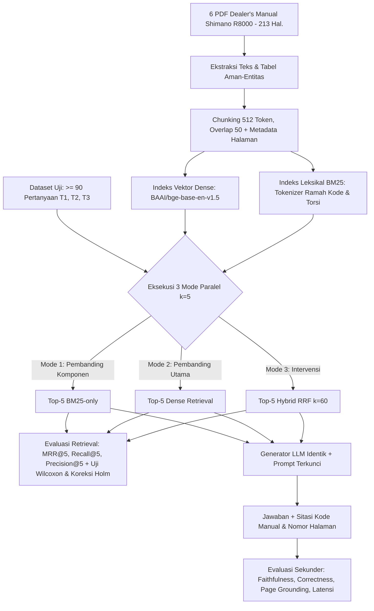

# Business Requirements Document (BRD) v0.2.1.1

**Judul Penelitian / Sistem (tetap):**
Analisis Perbandingan Dense Retrieval dan Hybrid Retrieval pada Sistem Retrieval-Augmented Generation untuk Tanya Jawab Perawatan Sepeda Berdasarkan Manual Teknis

| Atribut | Keterangan |
|---|---|
| Institusi | Fakultas Ilmu Komputer (FASILKOM), Universitas Esa Unggul |
| Penyusun | [ISI NAMA / NIM] |
| Dosen Pembimbing | [Diisi sesuai Dosen Pembimbing Akademik] |
| Versi | 0.2.1.1 (revisi pasca-audit kritik BRD × SLR putaran ketiga) |
| Tanggal | 14 November 2026 |

**Riwayat Revisi**

| Versi | Perubahan |
|---|---|
| 0.1 | Draf awal (25 FR) |
| 0.2 | (1) BM25-only ditambahkan sebagai pembanding komponen; (2) FR dipangkas dari 25 menjadi 20, dengan prioritas ulang; (3) klaim yang tidak didukung literatur diubah menjadi hipotesis eksplisit; (4) setiap sasaran diberi status dukungan literatur; (5) ditambah bagian hipotesis, taksonomi tipe pertanyaan, dan kriteria keberhasilan; (6) stakeholder dekoratif dihapus; (7) risiko kontribusi tipis dan perluasan cakupan ditambahkan |
| 0.2.1.1 | (1) Penetapan K-01 (bahasa Inggris) dan K-02 (6 *Dealer's Manual* Shimano Ultegra R8000, 213 halaman, beserta ketentuan lisensi lokal dan parafrase jawaban acuan); (2) perbaikan klaim *gap* BO-02 berbasis hasil pencarian kueri S4 (n = 0), bukan ekstrapolasi domain lain; (3) fokus BO-07 pada perbandingan latensi *retrieval* tanpa ambang 5 detik tanpa sumber; (4) jadwal diperbarui menjadi 16 minggu mencakup SLR, pilot ekstraksi, penulisan, dan penyangga (*buffer*); (5) aturan tokenisasi BM25 untuk kode komponen bertanda hubung (`RD-R8000`) dan satuan torsi (`N·m`) ditambahkan pada FR-02 dan FR-05; (6) penguncian uji statistik utama (Wilcoxon *signed-rank* dengan pemeriksaan ketahanan *paired bootstrap*, α = 0,05, koreksi Holm), rumus Recall@5 multi-*chunk*, dan *Cohen's kappa* pada Bagian 2.4; (7) penajaman tiga pilar kontribusi dan penyelarasan penuh Lampiran A dengan SLR v0.2.1.1 |

> **Dokumen induk:** BRD ini diturunkan dari **PICOS v2**. Pemetaan RQ ke sasaran: RQ 1.1 → BO-02, BO-05; RQ 1.2 → BO-01; RQ 1.3a → BO-03, BO-04, BO-05; RQ 1.3b → BO-06, BO-07.
>
> **Keputusan kunci yang telah ditetapkan (Gerbang G0):**
> - **K-01 (Bahasa manual dan pertanyaan):** Ditetapkan (12 November 2026). Manual, pertanyaan, jawaban sistem, dan jawaban acuan memakai **bahasa Inggris**. Alasan: manual resmi yang dipilih berbahasa Inggris, dan penggunaan satu bahasa yang seragam menjaga perbandingan BM25, Dense, dan Hybrid RRF tetap adil tanpa bias translasi.
> - **K-02 (Manual yang dipakai dan ketentuan lisensinya):** Ditetapkan (12 November 2026). Korpus terdiri atas **enam *Dealer's Manual* resmi Shimano Ultegra R8000 berbahasa Inggris (total 213 halaman)** yang diunduh dari portal resmi `si.shimano.com`: `DM-RAFD001-05` (*Front Derailleur*, 25 hal.), `DM-RARD001-04` (*Rear Derailleur*, 26 hal. — ditetapkan sebagai **subset pilot**), `DM-RACBR01-03` (*Dual-Pivot Brake Caliper*, 54 hal.), `DM-RADBR01-11` (*Hydraulic Disc Brake / Mechanical Shifting*, 72 hal.), `DM-RAFC001-04` (*Crankset*, 21 hal.), dan `DM-RACS001-03` (*Cassette Sprocket & Chain*, 15 hal.). Sesuai ketentuan penggunaan pada `si.shimano.com`, hak cipta dokumen milik Shimano Inc. dan disediakan untuk referensi teknis; dalam penelitian akademik ini berkas PDF hanya disimpan secara lokal (tidak diunggah atau didistribusikan ulang ke repositori publik, melainkan hanya disertai skrip pengunduh resmi dan *checksum* SHA-256), serta jawaban acuan disusun sebagai **parafrase teknis dengan rujukan halaman**, bukan salinan teks mentah.
>
> Referensi literatur di dokumen ini merujuk kode studi pada dokumen **SLR v0.2.1.1 (`S01–S25`)**. Mengingat penelusuran 11 November 2026 merupakan penyaringan awal berbantuan Scopus AI (`n = 55`) dan Peta Penelitian (`n = 17`), rincian angka metrik dari studi pembanding baru dikutip sebagai bukti definitif setelah pembacaan teks lengkap (`A-07`) selesai.

---

## 1. Executive Summary

### 1.1 Latar Bisnis

Informasi perawatan sepeda (penyetelan, pelumasan, penggantian komponen, ukuran, nilai torsi) terdapat dalam manual teknis yang panjang dan mencakup beberapa sub-model komponen sekaligus. Informasinya tersebar dan memakai istilah komponen serta kode seri spesifik (seperti `RD-R8000-SS`, `FD-R8000`, `BR-R8070`), sehingga pengguna harus menemukan sendiri bagian yang tepat sebelum bisa bertindak.

*Retrieval-Augmented Generation* (RAG) mengambil potongan dokumen (*chunk*) yang relevan lalu memakainya sebagai konteks bagi model bahasa (LLM). Mutu jawaban bergantung pada mutu pencarian. Tiga strategi pencarian dibandingkan pada kondisi uji yang identik: **BM25-only** (leksikal, sebagai pembanding komponen), **Dense Retrieval** (kedekatan makna vektor tunggal, sebagai pembanding utama), dan **Hybrid Retrieval** (penggabungan Dense + BM25 dengan *Reciprocal Rank Fusion*/RRF).

### 1.2 Masalah yang Diteliti dan Posisi Kontribusi

1. **Strategi pencarian pada manual teknis sepeda:** Perbandingan BM25, Dense, dan Hybrid telah diteliti pada benchmark umum maupun domain finansial/multi-dokumen (S02, S18, S19), sehingga perbandingan "Dense vs. Hybrid" semata **bukanlah celah metodologis baru**. Namun, belum diketahui bagaimana interaksi ketiga strategi tersebut pada manual teknis perawatan sepeda yang menggabungkan kode komponen bertanda hubung, tabel nilai torsi, dan prosedur multi-langkah.
2. **Ketiadaan dataset berlabel di domain sepeda:** Berdasarkan penelusuran kueri `S4` pada basis data Scopus (11 November 2026; `n = 0`), belum ditemukan dataset tanya jawab perawatan sepeda dengan label relevansi tingkat *chunk*.
3. **Tiga pilar nilai tambah (kontribusi) penelitian ini:** Penelitian ini tidak mengklaim kebaruan algoritma RRF, melainkan berfokus pada tiga artefak yang dapat diuji:
   - **Dataset QA perawatan sepeda berlabel relevansi tingkat *chunk* (`qrels`)** dengan aturan pelabelan multi-model dan jawaban acuan terparafrase beserta rujukan halaman;
   - **Analisis empiris per tipe pertanyaan (T1, T2, T3)**—khususnya pengujian ketahanan BM25, Dense, dan Hybrid RRF pada tipe **T1 (leksikal-presisi)** yang memuat kode komponen dan nilai torsi;
   - **Kerangka uji (*evaluation harness*) yang sepenuhnya reproduksibel** dengan pra-registrasi aturan statistik sebelum evaluasi penuh dijalankan.

### 1.3 Hipotesis Kerja

Pernyataan berikut adalah **hipotesis penulis yang akan diuji secara empiris**: manual teknis sepeda memuat entitas leksikal presisi (kode komponen seperti `RD-R8000`, ukuran baut, dan satuan torsi `N·m`) yang diduga lebih mudah ditangkap oleh pencocokan leksikal BM25/Hybrid dibanding *Dense Retrieval* murni (Tipe T1), sedangkan pertanyaan deskriptif-parafrase (Tipe T2) diduga lebih cocok bagi *Dense Retrieval*. Penelitian ini menguji dugaan tersebut secara dua arah (*two-tailed*) dan tidak mengasumsikannya pasti benar. **Hasil nol (*null result*) yang menunjukkan tidak adanya perbedaan signifikan antar sistem dinyatakan sebagai temuan ilmiah yang sah.**

### 1.4 Tujuan Sistem

Membangun prototipe sistem tanya jawab RAG berbasis manual teknis yang berfungsi sebagai **sarana eksperimen terkontrol**: tiga mode retrieval (BM25-only, Dense, Hybrid RRF) dijalankan pada korpus (6 *Dealer's Manual* Shimano Ultegra R8000, 213 halaman), strategi *chunking* (`512` token, *overlap* `50`), kumpulan pertanyaan (`≥ 90` pertanyaan), dan model bahasa yang sama, lalu dievaluasi dengan metrik peringkat, uji statistik berpasangan, analisis per tipe pertanyaan, dan analisis kegagalan.

---

## 2. Business Objectives & Success Metrics

### 2.1 Sasaran dan Jadwal 16 Minggu

**Inti** = wajib ada pada hasil utama. **Sekunder** = dilaporkan secara eksploratif, tidak menjadi dasar klaim kemenangan sistem.

| ID | Peran | Sasaran (Specific) | Indikator (Measurable) | Target | Waktu | Status dukungan literatur |
|---|---|---|---|---|---|---|
| BO-01 | Inti | Prototipe eksperimen tiga mode retrieval pada pipeline yang sama (diawali pilot ekstraksi `DM-RARD001-04`) | Tiga mode berjalan pada pertanyaan yang sama dengan konfigurasi dan tokenisasi BM25 tercatat | 1 prototipe; pilot 26 hal. lulus verifikasi; seluruh FR *Must* terpenuhi | Minggu 2–8 | Teknik tersedia (S02, S05, S18, S21) |
| BO-02 | Inti | Dataset pertanyaan dan jawaban acuan terparafrase dengan label relevansi tingkat *chunk* | Jumlah pertanyaan per tipe, aturan multi-model, dan kesepakatan pelabelan (*Cohen's kappa*) | ≥ 30 pertanyaan per tipe (total ≥ 90 pertanyaan); $\kappa \ge 0{,}70$ pada sampel anotator kedua | Minggu 4–8 | **Tidak ditemukan pada penelusuran kueri S4 di Scopus (11 Nov 2026; n = 0)** |
| BO-03 | Inti | Membandingkan BM25-only, Dense, dan Hybrid RRF pada MRR, Recall@k, dan Precision@k | Nilai metrik untuk tiga sistem pada seluruh pertanyaan | $k = 5$, konstanta $\text{RRF} = 60$ | Minggu 9–12 | S02, S03, S18, S19 membandingkan retrieval pada domain non-sepeda (detail angka menunggu bacaan teks lengkap A-07) |
| BO-04 | Inti | Menguji signifikansi statistik selisih antar sistem | Uji berpasangan per pertanyaan, koreksi multi-metrik, ukuran efek, interval kepercayaan | Sesuai pra-registrasi Bagian 2.4 (Wilcoxon *signed-rank*, $\alpha = 0{,}05$, koreksi Holm) | Minggu 11–13 | Praktik metodologi standar; **bukan klaim gap** |
| BO-05 | Inti (pelaporan wajib; kesimpulan per tipe bersifat eksploratif) | Menganalisis kinerja per tipe pertanyaan (Bagian 2.3) dan analisis kegagalan | Metrik BO-03 dilaporkan per tipe (T1, T2, T3) beserta taksonomi galat | Seluruh 3 tipe dilaporkan | Minggu 11–13 | **Hipotesis operasional penulis** (terkait konsep *lexical-semantic divide* pada S18, S25) |
| BO-06 | Sekunder | Menilai kualitas jawaban dan ketepatan rujukan halaman | *Faithfulness*, *answer correctness*, ketepatan rujukan halaman (*page grounding*) | Pada seluruh pertanyaan; validasi manual pada sampel 30 pertanyaan (10 per tipe) dengan pelaporan kesepakatan | Minggu 12–14 | Kerangka evaluasi S12, S13 (*faithfulness*) dan S23 (*page number grounding*) |
| BO-07 | Sekunder | Mencatat dan membandingkan latensi retrieval antar sistem (serta mencatat latensi *end-to-end* secara deskriptif) | Latensi retrieval (ms/kueri) dan *end-to-end* (detik/kueri) pada perangkat yang sama | Perbandingan langsung latensi *retrieval* antar tiga mode (tanpa ambang detik arbitrer karena latensi *end-to-end* didominasi LLM) | Minggu 12–14 | S02, S03, S18 mencatat efisiensi waktu/komputasi; dilaporkan secara eksploratif |

**Rincian Alokasi Waktu 1 Semester (16 Minggu Efektif termasuk Penyangga):**
- **Minggu 1–3 (SLR & Pilot Ekstraksi):** Eksekusi penelusuran literatur, verifikasi teks lengkap (`A-07`), serta uji pilot ekstraksi dan tokenisasi pada `DM-RARD001-04` (26 halaman).
- **Minggu 4–8 (Pembangunan Sistem & Pelabelan Dataset):** Implementasi indeks vektor (`BAAI/bge-base-en-v1.5`) dan BM25 pada 6 manual (213 halaman), penyusunan $\ge 90$ pertanyaan beserta label *chunk* relevan, validasi sampel anotator kedua, dan penguncian pra-registrasi statistik.
- **Minggu 9–12 (Evaluasi Utama):** Eksekusi evaluasi *batch* tiga mode retrieval (`BO-03`), uji statistik berpasangan (`BO-04`), dan pemetaan hasil per tipe pertanyaan (`BO-05`).
- **Minggu 13–14 (Evaluasi Sekunder & Analisis Kegagalan):** Evaluasi *faithfulness*, *answer correctness*, validasi manual 30 sampel (`BO-06`), pengukuran latensi retrieval (`BO-07`), dan bedah kasus kegagalan.
- **Minggu 15–16 (Penulisan Laporan & Penyangga/*Buffer*):** Penyelesaian naskah bab hasil/pembahasan, pengemasan repositori reproduksibel (`make eval`), dan cadangan waktu mitigasi risiko.

### 2.2 Hipotesis Statistik

| ID | Hipotesis | Jenis |
|---|---|---|
| H0-1 | Tidak ada perbedaan MRR@5 antara Hybrid RRF dan Dense Retrieval | Konfirmatori |
| H1-1 | Ada perbedaan MRR@5 antara Hybrid RRF dan Dense Retrieval (uji dua arah) | Konfirmatori |
| H0-2 / H1-2 | Sama seperti H0-1/H1-1, untuk metrik Recall@5 | Konfirmatori |
| HE-1 | Pada tipe T1 (leksikal-presisi: kode komponen & nilai torsi), BM25-only atau Hybrid RRF cenderung lebih unggul dari Dense Retrieval | Eksploratif (dugaan arah) |
| HE-2 | Pada tipe T2 (deskriptif-parafrase), Dense Retrieval cenderung setara atau lebih unggul dari BM25-only | Eksploratif (dugaan arah) |

Hipotesis eksploratif (`HE-1`, `HE-2`) dilaporkan untuk mendiagnosis perilaku komponen dan tidak diklaim sebagai pengujian konfirmatori utama.

### 2.3 Taksonomi Tipe Pertanyaan (definisi operasional penulis)

| Tipe | Definisi Operasional | Contoh Bentuk Pertanyaan (Bahasa Inggris) |
|---|---|---|
| **T1 Leksikal-presisi** | Jawaban bergantung pada pencocokan eksak kode seri komponen (mis. `RD-R8000-GS`, `BR-R8070`), ukuran baut/alat (mis. `2 mm Allen key`), atau nilai torsi spesifik (`N·m`) | *"What is the tightening torque in N·m for the cable fixing bolt on the RD-R8000 rear derailleur?"* |
| **T2 Deskriptif-parafrase** | Pertanyaan mendeskripsikan gejala atau fungsi dengan bahasa sehari-hari tanpa menyebut kode komponen atau istilah teknis persis di judul bagian manual | *"Why does the chain keep rubbing or making noise when riding on the largest front chainring and smallest rear gear?"* |
| **T3 Prosedural** | Jawaban menuntut urutan langkah kerja penyetelan, pemasangan, atau perawatan yang berurutan | *"What are the step-by-step procedures to bleed air from the hydraulic disc brake caliper?"* |

### 2.4 Kriteria Keberhasilan dan Pra-Registrasi Analisis Statistik (Dikunci Sebelum Evaluasi)

Aturan berikut dikunci sebelum evaluasi penuh dijalankan untuk mencegah *p-hacking* dan perubahan metrik pasca-pengujian:

1. **Konfigurasi Sistem Terkunci:** Tiga mode (*BM25-only*, *Dense* `BAAI/bge-base-en-v1.5`, *Hybrid RRF* dengan konstanta $\text{RRF} = 60$) diuji pada *chunk* yang identik (`chunk_size = 512` token, `chunk_overlap = 50` token) dengan kedalaman pengambilan $k = 5$.
2. **Definisi Eksak Metrik Multi-*Chunk*:**
   - **MRR@5:** $\frac{1}{|Q|} \sum_{q=1}^{|Q|} \frac{1}{\text{rank}_q}$, di mana $\text{rank}_q$ adalah peringkat *chunk* relevan pertama dalam daftar 5 teratas (bernilai $0$ jika tidak ada *chunk* relevan di 5 teratas).
   - **Recall@5 (untuk satu atau beberapa *chunk* relevan):** $\text{Recall@5}(q) = \frac{|\text{Retrieved@5}(q) \cap \text{Relevant}(q)|}{|\text{Relevant}(q)|}$, di mana $\text{Relevant}(q)$ adalah himpunan seluruh ID *chunk* yang dilabeli relevan untuk pertanyaan $q$.
   - **Precision@5 (pendukung):** $\text{Precision@5}(q) = \frac{|\text{Retrieved@5}(q) \cap \text{Relevant}(q)|}{5}$.
3. **Uji Statistik Utama & Koreksi Multi-Metrik:**
   - **Uji Utama:** Uji non-parametrik berpasangan **Wilcoxon *signed-rank test*** dua arah (*two-tailed*) pada skor per pertanyaan ($\alpha = 0{,}05$).
   - **Pemeriksaan Ketahanan (*Robustness Check*):** *Paired bootstrap resampling* (10.000 iterasi) untuk menghasilkan interval kepercayaan 95% (*95% Confidence Interval*) dari selisih rata-rata metrik.
   - **Ukuran Efek (*Effect Size*):** *Rank-biserial correlation* ($r$) dilaporkan mendampingi nilai-$p$.
   - **Koreksi Multi-Pengujian:** Prosedur **Holm-Bonferroni** diterapkan pada keluarga dua metrik konfirmatori utama (`MRR@5` dan `Recall@5`).
4. **Kriteria Keberhasilan & Perlakuan Hasil Nol:** *Hybrid RRF* dinyatakan unggul secara konfirmatori apabila melampaui *Dense Retrieval* secara signifikan (setelah koreksi Holm pada $\alpha = 0{,}05$) pada `MRR@5` dan `Recall@5`. Apabila tidak tercapai, hipotesis nol ($H_0$) dipertahankan dan dilaporkan secara jujur sebagai hasil nol (*null result*), disertai bedah penyebab melalui pembanding *BM25-only* dan analisis per tipe pertanyaan.
5. **Ukuran Kesepakatan Validasi:** Kesepakatan pelabelan relevansi *chunk* (pada sampel 30 pertanyaan oleh anotator kedua) dan validasi manual terhadap penilai otomatis (*LLM-judge*) diukur menggunakan **Cohen's kappa ($\kappa$)** untuk klasifikasi biner/kategorikal serta **persentase kesepakatan (% agreement)** dan korelasi peringkat **Spearman ($\rho$)** untuk skor kualitas jawaban.

---

## 3. Scope

### 3.1 In-Scope

1. **Korpus Manual Teknis:** Enam dokumen resmi *Shimano Ultegra R8000 Dealer's Manual* berbahasa Inggris dengan total **213 halaman** (`DM-RAFD001-05`, `DM-RARD001-04`, `DM-RACBR01-03`, `DM-RADBR01-11`, `DM-RAFC001-04`, dan `DM-RACS001-03`), diakses dari `si.shimano.com` pada 12 November 2026. Dokumen *Exploded View* (`EV`) dan tabel katalog *Torque Chart* terpisah tidak dimasukkan ke korpus utama.
2. **Subset Pilot:** Dokumen `DM-RARD001-04` (*Rear Derailleur*, 26 halaman) digunakan untuk uji pilot ekstraksi PDF, pelestarian tabel torsi, dan verifikasi tokenisasi kode komponen.
3. Ekstraksi teks, pembersihan aman-entitas, *chunking* terparameter, *embedding* (`BAAI/bge-base-en-v1.5`), indeks vektor, dan indeks BM25 dengan tokenisasi yang mempertahankan kode bertanda hubung.
4. Tiga mode retrieval: *BM25-only*, *Dense*, dan *Hybrid RRF*.
5. Pembangkitan jawaban dari konteks terambil dengan penambatan nomor halaman (*page grounding*).
6. Dataset $\ge 90$ pertanyaan dan jawaban acuan terparafrase dengan label relevansi tingkat *chunk* serta aturan multi-model.
7. Evaluasi retrieval, uji statistik berpasangan, analisis per tipe (T1–T3), dan analisis kegagalan.
8. Evaluasi kualitas jawaban (sekunder) dan perbandingan latensi retrieval (sekunder).
9. Antarmuka web satu halaman dalam kontainer Docker untuk demonstrasi eksperimen.

### 3.2 Out-of-Scope

1. *Reranking* tahap kedua (misalnya *cross-encoder*), ColBERT (*late interaction*), *query rewriting*, dan metode retrieval di luar tiga mode yang diuji.
2. *Fine-tuning* model *embedding* maupun model bahasa.
3. Pemrosesan gambar dan diagram (*multimodal* OCR/VLM).
4. **Uji pengguna akhir** dan pengukuran kepuasan pengguna.
5. Diagnosis kerusakan otomatis di luar isi tekstual manual.
6. Autentikasi, pembayaran, aplikasi *mobile*, dan *deployment* komersial publik.
7. Jaminan keselamatan mekanis; keluaran sistem adalah objek riset akademik dan tidak menggantikan mekanik tersertifikasi.

---

## 4. Stakeholder Analysis

| Stakeholder | Peran | Kepentingan | Influence |
|---|---|---|---|
| Peneliti / Mahasiswa | Perancang, pengembang, penguji | Menghasilkan eksperimen, dataset berlabel, dan evaluasi yang valid serta reproduksibel | Tinggi |
| Dosen Pembimbing | Pembimbing metodologi | Kelayakan desain eksperimen, kepatuhan kaidah ilmiah, dan kejujuran pelaporan | Tinggi |
| Dosen Penguji | Penilai proposal dan sidang | Ketajaman kontribusi, validitas statistik, dan transparansi batasan | Tinggi |
| Program Studi / FASILKOM | Pemangku kebijakan akademik | Kesesuaian dengan standar Tugas Akhir universitas | Sedang |
| Pemilik hak cipta manual (Shimano Inc.) | Pemilik dokumen sumber | Penggunaan wajar terbatas untuk riset akademik tanpa redistribusi berkas PDF | Rendah |
| Peneliti berikutnya | Pengguna lanjutan dataset & *harness* | Kemudahan mereproduksi hasil melalui skrip unduh dan konfigurasi terkunci | Rendah |

*Catatan:* pengguna akhir (pesepeda, mekanik) dan pakar mekanik tidak dicantumkan sebagai *stakeholder* aktif karena penelitian ini murni berfokus pada evaluasi sistem secara *offline* berbasis *ground truth* teks manual tanpa uji pengguna.

---

## 5. Functional Requirements

Prioritas MoSCoW: M = Must, S = Should, C = Could. Total 20 FR (14 *Must*, 4 *Should*, 2 *Could*).

| ID | Kebutuhan | Deskripsi | Prio | Sasaran |
|---|---|---|---|---|
| FR-01 | Pemuatan dan ekstraksi manual | Sistem memuat PDF manual dan mengekstrak teks beserta tabel spesifikasi per halaman dengan struktur bagian | M | BO-01 |
| FR-02 | Pembersihan teks aman entitas | Normalisasi teks tanpa merusak kode komponen bertanda hubung (`RD-R8000-SS`), ukuran baut (`M4`), dan simbol satuan torsi (`N·m`, `kgf·m`, `in.·lbs.`); diverifikasi pada pilot `DM-RARD001-04` | M | BO-01 |
| FR-03 | *Chunking* terparameter | Ukuran *chunk* (`512` token) dan *overlap* (`50` token) dapat dikonfigurasi; metadata (`doc_id`, halaman, judul bagian, `chunk_id`) dipertahankan | M | BO-01 |
| FR-04 | *Embedding* dan indeks vektor | Vektor dibuat dengan model `BAAI/bge-base-en-v1.5` dan diindeks untuk pencarian kemiripan kosinus | M | BO-01 |
| FR-05 | Indeks BM25 ramah kode teknis | Dibangun pada *chunk* yang identik dengan FR-03; *tokenizer* dikonfigurasi (via pola *regex* alfanumerik + tanda hubung/titik tengah) agar tidak memecah kode seri seperti `RD-R8000` atau satuan `N·m`, serta menyediakan opsi pencocokan token utuh maupun sub-token | M | BO-01 |
| FR-06 | Tiga mode retrieval | BM25-only, Dense, dan Hybrid RRF ($\text{RRF\_k} = 60$) dipanggil melalui satu antarmuka seragam dengan $k = 5$ | M | BO-01, BO-03 |
| FR-07 | Pembangkitan jawaban | LLM menyusun jawaban hanya dari konteks terambil; *prompt*, suhu (`temperature = 0`), dan parameter identik untuk semua mode | M | BO-01 |
| FR-08 | Rujukan sumber | Jawaban menampilkan `doc_id`, `chunk_id`, dan nomor halaman manual yang menjadi dasar jawaban | M | BO-06 |
| FR-09 | Dataset QA dan label relevansi multi-model | Memuat $\ge 90$ pertanyaan (30 per tipe T1, T2, T3), jawaban acuan berupa **parafrase teknis** (bukan salinan teks mentah), daftar `chunk_id` relevan, nomor halaman, serta pedoman tertulis pelabelan ketika satu manual membahas beberapa sub-model (mis. `SS` vs `GS`) | M | BO-02 |
| FR-10 | Evaluasi retrieval *batch* | MRR@5, Recall@5, dan Precision@5 dihitung secara otomatis untuk tiga mode pada seluruh pertanyaan | M | BO-03 |
| FR-11 | Pencatatan latensi terpisah | Latensi *retrieval* (ms) dan latensi generasi LLM/*end-to-end* (detik) dicatat secara terpisah per pertanyaan dan per mode | M | BO-07 |
| FR-12 | Uji statistik | Menjalankan uji berpasangan Wilcoxon *signed-rank*, *paired bootstrap* CI 95%, ukuran efek $r$, dan koreksi Holm sesuai pra-registrasi Bagian 2.4 | M | BO-04 |
| FR-13 | Analisis per tipe pertanyaan | Metrik FR-10 dilaporkan secara terpisah untuk tipe T1, T2, dan T3 | M | BO-05 |
| FR-14 | Pengunci konfigurasi dan reproduksi | Semua parameter tersimpan dalam berkas konfigurasi; satu perintah (`make eval`) mereproduksi tabel evaluasi utama | M | BO-01 |
| FR-15 | Evaluasi kualitas jawaban | *Faithfulness* dan *answer correctness* dinilai; penilai otomatis divalidasi manual pada sampel 30 pertanyaan dengan pelaporan kesepakatan | S | BO-06 |
| FR-16 | Penolakan jawaban (*abstention*) | Sistem menyatakan informasi tidak ditemukan di manual bila konteks terambil tidak memuat bukti jawaban | S | BO-06 |
| FR-17 | Antarmuka web dan kontainer | Satu halaman demonstrasi: pilihan mode, tampilan jawaban dengan rujukan halaman, dan waktu retrieval; berjalan dalam Docker | S | BO-01 |
| FR-18 | Ekspor hasil dan analisis kegagalan | Hasil per pertanyaan diekspor (CSV/JSON); kasus gagal dikelompokkan berdasarkan penyebab (mis. kegagalan tokenisasi kode, pemotongan tabel, atau ambiguitas sub-model) | S | BO-03, BO-05 |
| FR-19 | Tampilan berdampingan | Dua mode ditampilkan berdampingan untuk pertanyaan yang sama | C | BO-01 |
| FR-20 | Tampilan potongan terambil | Daftar *top-5 chunk* terambil beserta peringkat dan skor masing-masing mode | C | BO-01 |

---

## 6. Non-Functional Requirements

**Performance (sekunder, diukur dan dilaporkan):** Latensi *retrieval* (ms) dan *end-to-end* (detik) dicatat pada perangkat keras lokal peneliti (prosesor x86_64/ARM, RAM ≥ 16 GB); perbandingan efisiensi difokuskan pada selisih latensi *retrieval* antar tiga mode tanpa mengklaim batas waktu mutlak sebelum data terkumpul. Eksekusi evaluasi *batch* retrieval pada 90 pertanyaan dapat diulang dalam ≤ 15 menit.

**Security dan Kepatuhan Lisensi (untuk prototipe riset lokal):**

| ID | Kebutuhan | Ukuran |
|---|---|---|
| NFR-S01 | Kunci API disimpan di berkas `.env`, tidak di dalam kode sumber | `.env` masuk ke `.gitignore`; repositori menyediakan `.env.example` |
| NFR-S02 | Kepatuhan hak cipta manual Shimano | Berkas PDF manual **tidak diunggah** ke repositori publik; repositori hanya memuat daftar URL resmi `si.shimano.com`, skrip pengunduh, dan verifikasi *checksum* SHA-256 |

**Usability:** Antarmuka web satu halaman cukup untuk demonstrasi fungsional saat sidang. Tidak ada klaim ketergunaan (*usability*) karena uji pengguna berada di luar cakupan.

**Reliability dan Reprodusibilitas:**

| ID | Kebutuhan | Ukuran |
|---|---|---|
| NFR-R01 | Retrieval deterministik | Eksekusi ulang dengan konfigurasi yang sama menghasilkan nilai MRR@5, Recall@5, dan Precision@5 yang 100% identik |
| NFR-R02 | Pengendalian variasi keluaran LLM | Versi model, `temperature = 0`, dan `seed` dicatat pada log setiap eksekusi |
| NFR-R03 | Konsistensi indeks lintas mode | Himpunan `chunk_id` dan teks potongan identik 100% antara indeks vektor Dense dan indeks BM25 |
| NFR-R04 | Penanganan galat layanan eksternal | Galat pemanggilan LLM dicatat dan dicoba ulang otomatis maksimal 3 kali (*exponential backoff*) tanpa menghentikan proses evaluasi *batch* |

---

## 7. Business Process As-Is vs To-Be

| Aspek | As-Is (Manual) | To-Be (Sarana Eksperimen RAG) |
|---|---|---|
| Mencari spesifikasi/prosedur | Membuka 6 PDF panjang (213 halaman), mencari kata kunci secara manual di tiap berkas | Mengajukan pertanyaan bahasa alami pada satu antarmuka terpadu |
| Variasi istilah & kode komponen | Pencarian teks biasa gagal jika pengguna memakai parafrase; pencarian semantik murni berisiko meleset pada kode seri spesifik | Sistem membandingkan secara terukur kinerja BM25, Dense, dan Hybrid RRF pada pertanyaan leksikal (T1), parafrase (T2), dan prosedural (T3) |
| Keterlacakan sumber | Pengguna harus mencocokkan halaman manual secara manual | Jawaban menyertakan kode dokumen (`DM-xxxx`), `chunk_id`, dan nomor halaman asli |
| Bukti evaluasi | Klaim keunggulan metode bersifat asumtif | Evaluasi terkontrol dengan metrik peringkat, uji statistik berpasangan, dan *harness* yang dapat direproduksi |

---

## 8. Assumptions & Constraints

### 8.1 Asumsi

| ID | Asumsi | Status |
|---|---|---|
| AS-01 | Enam PDF *Dealer's Manual* Shimano Ultegra R8000 merupakan dokumen digital asli (*born-digital*) yang teksnya dapat diekstrak tanpa OCR | Dikonfirmasi pada berkas sumber; diuji detail tabelnya pada pilot `DM-RARD001-04` |
| AS-02 | Bahasa manual, pertanyaan, jawaban sistem, dan jawaban acuan seragam memakai bahasa Inggris | Dikunci melalui keputusan **K-01** |
| AS-03 | Penggunaan manual secara lokal untuk penelitian akademik tanpa redistribusi berkas PDF mematuhi ketentuan hak cipta | Dikunci melalui keputusan **K-02**; jawaban acuan ditulis sebagai parafrase dengan sitasi halaman |
| AS-04 | Model *embedding* (`BAAI/bge-base-en-v1.5`) dijalankan secara lokal sehingga bebas dari gangguan kuota API eksternal | Ditetapkan dalam desain sistem |
| AS-05 | Ukuran sampel $\ge 90$ pertanyaan (30 per tipe) memadai untuk pengujian berpasangan non-parametrik pada seluruh pertanyaan | Dievaluasi bersama pelaporan ukuran efek dan interval kepercayaan *bootstrap* |

### 8.2 Batasan

| ID | Batasan |
|---|---|
| CO-01 | Waktu pelaksanaan dibatasi satu semester akademik (16 minggu efektif, termasuk penyangga waktu) |
| CO-02 | Komputasi terbatas pada perangkat keras lokal peneliti (prosesor x86_64/ARM, RAM ≥ 16 GB, tanpa klaster GPU khusus) |
| CO-03 | Anggaran inferensi LLM dibatasi pada penggunaan model lokal (*open-weights*) atau kuota API penelitian mahasiswa (≤ Rp500.000) |
| CO-04 | Cakupan korpus terbatas pada satu produsen dan satu seri komponen (*Shimano Ultegra R8000*, 213 halaman); temuan tidak digeneralisasi secara otomatis ke seluruh merek sepeda |
| CO-05 | Penilai otomatis kualitas jawaban (*LLM-judge*) wajib divalidasi manual pada sampel 30 pertanyaan |
| CO-06 | Judul penelitian Tugas Akhir telah terdaftar dan tidak diubah |

---

## 9. Risk Register

| ID | Risiko | Prob. | Dampak | Mitigasi |
|---|---|---|---|---|
| R-01 | Ketidaksesuaian bahasa antara kueri dan manual merugikan BM25 | Rendah | Tinggi | Sudah dimitigasi penuh melalui penguncian bahasa Inggris seragam (**K-01**) |
| R-02 | Bias pelabelan karena penyusun pertanyaan juga melabeli *chunk* relevan | Sedang | Tinggi | Pedoman tertulis pelabelan multi-model; validasi silang oleh anotator kedua pada sampel 30 pertanyaan dengan pelaporan *Cohen's kappa* ($\kappa$) |
| R-03 | Ekstraksi PDF merusak tabel torsi atau *tokenizer* BM25 memecah kode `RD-R8000` | Sedang | Tinggi | Eksekusi pilot ekstraksi pada `DM-RARD001-04` (Minggu 2–3) dan pengujian unit *tokenizer* BM25 pada daftar kode komponen serta satuan torsi sebelum evaluasi penuh |
| R-04 | Hasil nol (*null result*) atau efek langit-langit (*ceiling effect*) karena korpus berukuran 213 halaman | Sedang | Sedang | Pra-registrasi aturan statistik; hasil nol dinyatakan sah; nilai tambah tetap terjaga melalui analisis per tipe pertanyaan (T1–T3) dan bedah kasus kegagalan |
| R-05 | Ambiguitas sub-model di dalam satu manual (mis. `RD-R8000-SS` vs `GS`) mengacaukan label relevansi | Sedang | Tinggi | Aturan eksplisit pada FR-09: pertanyaan harus menyebut sub-model secara spesifik jika nilainya berbeda, atau himpunan `Relevant(q)` harus mencakup seluruh *chunk* sub-model yang sah |
| R-06 | **Kontribusi dinilai tipis** karena S18 dan S19 sudah membandingkan BM25, Dense, dan Hybrid di domain lain | Sedang | Tinggi | Tidak mengklaim perbandingan "Dense vs Hybrid" sebagai kebaruan tunggal; memosisikan kontribusi pada 3 pilar: (1) dataset QA manual sepeda berlabel `qrels`, (2) analisis tipe T1 (kode komponen & torsi), dan (3) *harness* evaluasi reproduksibel |
| R-07 | Perluasan cakupan (*scope creep*) dan jadwal molor | Sedang | Sedang | FR dipangkas menjadi 20 (14 *Must*); BO-06 dan BO-07 diposisikan sekunder; jadwal 16 minggu memiliki penyangga di Minggu 15–16 |
| R-08 | Penilai otomatis jawaban (*LLM-judge*) bias atau tidak konsisten | Sedang | Sedang | `temperature = 0`; validasi manual pada 30 pertanyaan (10 per tipe) dan pelaporan tingkat kesepakatan |
| R-09 | Risiko hak cipta dokumen Shimano | Rendah | Sedang | PDF tidak diunggah ke GitHub; repo hanya berisi skrip unduh resmi + SHA-256; jawaban acuan ditulis berupa parafrase |
| R-10 | Kredibilitas SLR diragukan jika hanya mengandalkan ringkasan awal Scopus AI tanpa verifikasi teks lengkap | Tinggi | Tinggi | Menyatakan secara transparan di SLR bahwa pencarian 11 Nov 2026 adalah penyaringan awal Scopus AI, menyimpan bukti Scopus ID/ekspor Boolean, dan tidak mengisi skor kualitas `QA` sebelum teks lengkap dibaca (`A-07`) |

---

## 10. Acceptance Criteria

| ID | Kriteria Penerimaan | Verifikasi | Terkait |
|---|---|---|---|
| AC-01 | Enam manual (213 hal.) diproses menjadi *chunk* beserta metadata; pemeriksaan sampel 20 *chunk* pada dokumen pilot (`DM-RARD001-04`) membuktikan tabel torsi, kode `RD-R8000`, dan simbol `N·m` tidak rusak | Laporan hasil pilot | FR-01 s.d. FR-03, FR-05 |
| AC-02 | Indeks vektor Dense dan indeks BM25 dibangun dari kumpulan `chunk_id` yang 100% identik; *tokenizer* BM25 terbukti mempertahankan keutuhan kode komponen bertanda hubung | Uji otomatis kesamaan ID & uji unit *tokenizer* | FR-04, FR-05, NFR-R03 |
| AC-03 | Tiga mode retrieval dapat dipanggil melalui satu antarmuka pada pertanyaan yang sama dengan parameter terkunci ($k = 5$, $\text{RRF\_k} = 60$) | Uji fungsional | FR-06 |
| AC-04 | Setiap jawaban sistem memuat rujukan `doc_id` dan nomor halaman yang dapat ditelusuri ke PDF asli | Pemeriksaan sampel | FR-08 |
| AC-05 | Dataset memuat $\ge 90$ pertanyaan (≥ 30 per tipe T1, T2, T3) dengan jawaban acuan terparafrase, label `chunk_id` relevan, aturan multi-model, dan nilai kesepakatan $\kappa$ pada sampel 30 pertanyaan | Tinjauan dataset & log kesepakatan | FR-09, BO-02 |
| AC-06 | Dokumen pra-registrasi analisis statistik dan kriteria keberhasilan dikunci (dengan penanda waktu/*commit*) **sebelum** skrip evaluasi penuh dijalankan | Riwayat *commit* Git | FR-12, BO-04 |
| AC-07 | MRR@5, Recall@5, dan Precision@5 terhitung untuk tiga mode; pemeriksaan manual pada 5 sampel pertanyaan cocok 100% dengan keluaran skrip | Verifikasi silang perhitungan | FR-10, BO-03 |
| AC-08 | Tabel hasil melaporkan metrik secara keseluruhan dan per tipe pertanyaan (T1, T2, T3), disertai analisis kegagalan dan pelaporan jujur bila terjadi hasil nol | Laporan evaluasi | FR-13, FR-18, BO-05 |
| AC-09 | Latensi *retrieval* (ms) dan *end-to-end* (detik) tercatat secara terpisah untuk ketiga mode pada perangkat keras yang sama | Log pengukuran waktu | FR-11, BO-07 |
| AC-10 | Penilai otomatis kualitas jawaban divalidasi manual pada sampel 30 pertanyaan (10 per tipe) dan tingkat kesepakatannya dilaporkan | Laporan validasi | FR-15, BO-06 |
| AC-11 | Perintah tunggal (`make eval`) menghasilkan kembali tabel metrik retrieval dengan angka yang identik | Uji reproduksibilitas | FR-14, NFR-R01 |
| AC-12 | Setiap sasaran pada BRD tertaut secara konsisten ke studi di SLR v0.2.1.1 atau dinyatakan tegas sebagai hipotesis/praktik metodologi penulis | Audit silang Lampiran A | Seluruh BO |
| AC-13 | Seluruh 14 FR berprioritas *Must* terpenuhi dan berfungsi | Daftar periksa FR | BO-01 |
| AC-14 | Seluruh ketetapan K-01, K-02, K-03, dan parameter desain konsisten di antara PICOS, BRD, dan SLR | Audit dokumen | Seluruh dokumen |

---

## Lampiran A. Keterlacakan Sasaran → FR → AC → Literatur SLR v0.2.1.1

| Sasaran | FR Terkait | AC Terkait | Rujukan pada SLR v0.2.1.1 | Status Dukungan |
|---|---|---|---|---|
| **BO-01** | FR-01 s.d. FR-08, FR-14, FR-17, FR-19, FR-20 | AC-01 s.d. AC-04, AC-11, AC-13 | S02, S05, S09, S18, S21 | Teknik pembangunan *pipeline* RAG manual teknis tersedia |
| **BO-02** | FR-09 | AC-05 | Penelusuran kueri S4 di Scopus (11 Nov 2026; `n = 0`); konteks domain lain: S05, S20, S22 | Tidak ditemukan dataset QA manual sepeda pada penelusuran S4 |
| **BO-03** | FR-06, FR-10, FR-18 | AC-07 | S02, S03, S18, S19 | Perbandingan retrieval didukung pada benchmark umum/non-sepeda (angka detail menunggu bacaan teks lengkap A-07) |
| **BO-04** | FR-12 | AC-06 | Praktik metodologi eksperimen IR (Wilcoxon *signed-rank*, *bootstrap*, koreksi Holm) | Praktik metodologi standar (bukan klaim gap) |
| **BO-05** | FR-13, FR-18 | AC-08 | Hipotesis operasional penulis; konsep terkait *lexical-semantic divide* pada S18, S25 | Hipotesis operasional penulis |
| **BO-06** | FR-08, FR-15, FR-16 | AC-04, AC-10 | S12 (RAGAs), S13 (ARES), S14 (RGB), S15 (FoRAG), S23 (*page grounding*) | Alat dan kerangka evaluasi sekunder tersedia |
| **BO-07** | FR-11 | AC-09 | S02, S03, S18 (pencatatan efisiensi waktu pencarian) | Eksploratif (fokus pada perbandingan latensi retrieval) |