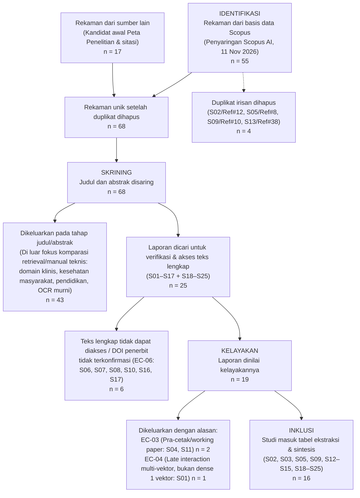

# Systematic Literature Review (SLR)

**Topik:** Analisis Perbandingan Dense Retrieval dan Hybrid Retrieval pada Sistem Retrieval-Augmented Generation untuk Tanya Jawab Perawatan Sepeda Berdasarkan Manual Teknis

| Atribut | Keterangan |
|---|---|
| Protokol | PRISMA 2020 |
| Rentang publikasi | 2021–2026 |
| Penyusun | [ISI NAMA / NIM] |
| Versi | 0.2.1.1 (Revisi pasca-audit putaran ketiga: sinkronisasi PRISMA, perbaikan EC-06 & penyelamatan S03, penguncian protokol S1–S5, dan transparansi status bacaan teks lengkap A-07) |
| Tanggal penguncian protokol | 10 November 2026 |
| Tanggal pencarian awal | 11 November 2026 (Penyaringan awal Scopus / Scopus AI & pelacakan Peta Penelitian) |

## Status Eksekusi Dokumen SLR (Versi 0.2.1.1)

1. **Transparansi Metode Penelusuran Awal:** Penelusuran literatur tahap awal dijalankan pada **11 November 2026** menggunakan penyaringan berbantuan **Scopus AI** pada basis data **Scopus** (`n = 55` rekaman terindeks lengkap dengan tautan Scopus ID) yang dipadukan dengan kandidat awal dari **Peta Penelitian / penelusuran sitasi** (`n = 17` rekaman: `S01–S17`).
2. **Hasil Penyaringan PRISMA:** Dari total `72` rekaman (`68` rekaman unik setelah penghapusan `4` duplikat irisan: `S02`, `S05`, `S09`, `S13`), sebanyak **16 studi (`S02`, `S03`, `S05`, `S09`, `S12`–`S15`, `S18`–`S25`)** lolos seleksi kelayakan untuk masuk ke dalam tabel ekstraksi dan sintesis.
3. **Kejujuran Status Bacaan Teks Lengkap (`A-07`) dan Skor Kualitas (`QA`):** Sesuai kaidah ilmiah yang ketat, metadata, fokus metode, dan arah temuan pada Bagian 5 saat ini merangkum data bibliografi terverifikasi serta sintesis awal Scopus/Peta Penelitian. **Penilaian skor kualitas (`QA1–QA4`) pada Bagian 7.2 tidak diisi dari abstrak atau ringkasan AI**, melainkan ditandai secara jujur sebagai *"Belum dinilai (menunggu bacaan teks lengkap A-07)"* sampai masing-masing berkas PDF selesai dibaca penuh dan diberi tanggal penilaian oleh peneliti.

---

## 1. Research Questions (RQ-SLR)

RQ-SLR diturunkan dari dokumen induk **PICOS v2** (RQ 1.1, 1.2, 1.3a, dan 1.3b). Cakupan subjek (S) pada pencarian literatur sengaja dibuat lebih luas daripada subjek eksperimen (mencakup manual teknis dan pemeliharaan lintas industri) untuk memetakan preseden metode sebelum dipersempit ke domain sepeda pada kueri `S4`.

| PICOS | Rumusan ringkas |
|---|---|
| P | Sistem tanya jawab berbasis RAG untuk dokumen teknis atau manual perawatan |
| I | *Hybrid Retrieval* (Dense + BM25 dengan RRF) |
| C | *Dense Retrieval* murni (pembanding utama) dan BM25-only (pembanding komponen untuk mengisolasi sumber keunggulan *Hybrid*), pada kondisi uji identik |
| O | **Utama (konfirmatori):** MRR@5 dan Recall@5, disertai uji signifikansi berpasangan (Wilcoxon *signed-rank* & *paired bootstrap*, koreksi Holm). **Pendukung:** Precision@5. **Sekunder (eksploratif):** *faithfulness*, *answer correctness*, ketepatan rujukan halaman, dan latensi retrieval. Seluruhnya dilaporkan juga per tipe pertanyaan (T1, T2, T3) |
| S | Manual teknis dan dokumen pemeliharaan (termasuk domain sepeda bila ada) |

| ID | Research Question | Terkait |
|---|---|---|
| RQ-SLR1 | Strategi retrieval apa saja (leksikal, *dense*, *hybrid*, *reranking*) yang dibandingkan pada penelitian RAG dan *information retrieval* periode 2021–2026, serta bagaimana teknik penggabungan peringkat (termasuk RRF) dilaporkan? | RQ 1.2 |
| RQ-SLR2 | Bagaimana kinerja *Dense* dibandingkan *Hybrid Retrieval* dan BM25, pada metrik dan dataset apa, dan dalam kondisi apa hasilnya berbeda? | RQ 1.3a |
| RQ-SLR3 | Bagaimana RAG diterapkan pada dokumen teknis, manual, dan pemeliharaan, dan karakteristik data apa (kode komponen, ukuran, satuan, prosedur) yang dilaporkan memengaruhi retrieval? | RQ 1.1 |
| RQ-SLR4 | Metrik dan kerangka evaluasi apa yang dipakai untuk menilai retrieval maupun jawaban RAG (misalnya Precision@k, Recall@k, MRR, *faithfulness*, *answer correctness*, *page grounding*, latensi), dan bagaimana keterbatasannya? | RQ 1.3a dan 1.3b |
| RQ-SLR5 | Celah penelitian apa yang tersisa pada aspek metodologis, dataset, konteks domain, dan performa, khususnya untuk perawatan sepeda? | Research gap |

---

## 2. Search Strategy & Protocol Log

### 2.1 Basis Data

| No. | Basis data | Peran | Status pada Putaran Ini |
|---|---|---|---|
| 1 | Scopus (termasuk penyaringan awal Scopus AI) | Utama | Dijalankan pada 11 November 2026 (`n = 55` rekaman terindeks) |
| 2 | IEEE Xplore | Utama | Pelacakan langsung DOI/judul kandidat (`S02`, `S03`, `S09`, `S18`, `S22–S24`) |
| 3 | ACM Digital Library | Utama | Pelacakan prosiding KDD / SIGMOD (`S15`) |
| 4 | ACL Anthology | Utama | Pelacakan prosiding EACL / NAACL / ACL (`S01`, `S12`, `S13`) |
| 5 | AAAI / SpringerLink / MDPI | Pendukung | Pelacakan prosiding AAAI (`S14`), CCIS (`S25`), dan MDPI *Applied Sciences* (`S05`) |
| 6 | Google Scholar | Pelengkap | Pelacakan sitasi dari Peta Penelitian (`n = 17` kandidat awal) |

*Pra-cetak (arXiv, SSRN)* dan *working paper* tanpa *peer-review* diperlakukan sebagai literatur abu-abu: dicatat pada alur seleksi dan dikeluarkan dari sintesis utama berdasarkan kriteria **EC-03**.

### 2.2 Blok Konsep (Kata Kunci)

| Blok | Isi |
|---|---|
| A (RAG) | `"retrieval-augmented generation"` OR `"retrieval augmented generation"` OR `"RAG system*"` |
| B (Retrieval) | `"dense retrieval"` OR `"dense passage retrieval"` OR `"semantic search"` OR `"vector search"` OR `"embedding-based retrieval"` |
| B2 (Hybrid / leksikal) | `"hybrid retrieval"` OR `"hybrid search"` OR `BM25` OR `"lexical retrieval"` OR `"sparse retrieval"` OR `"reciprocal rank fusion"` OR `RRF` |
| C (Domain) | `"technical manual*"` OR `"technical document*"` OR `"technical documentation"` OR `"maintenance manual*"` OR `maintenance` OR `repair` OR `bicycle*` |
| D (Evaluasi) | `evaluat*` OR `benchmark*` OR `"precision@k"` OR `"recall@k"` OR `MRR` OR `"mean reciprocal rank"` OR `faithfulness` OR `"answer correctness"` |
| E (Tugas) | `"question answering"` OR `"question-answering"` OR `chatbot` OR `"Q&A"` |

### 2.3 String Query Boolean (S1 s.d. S5)

**S1: Perbandingan retrieval dalam RAG (RQ-SLR1, RQ-SLR2)**
```text
TITLE-ABS-KEY(
  ("retrieval-augmented generation" OR "retrieval augmented generation" OR "RAG system*")
  AND ("dense retrieval" OR "dense passage retrieval" OR "semantic search" OR "vector search" OR "embedding-based retrieval")
  AND ("hybrid retrieval" OR "hybrid search" OR BM25 OR "lexical retrieval" OR "sparse retrieval" OR "reciprocal rank fusion" OR RRF)
)
AND PUBYEAR > 2020 AND PUBYEAR < 2027
```

**S2: RAG pada dokumen teknis dan pemeliharaan (RQ-SLR3)**
```text
TITLE-ABS-KEY(
  ("retrieval-augmented generation" OR "retrieval augmented generation")
  AND ("technical manual*" OR "technical document*" OR "technical documentation" OR "maintenance manual*" OR maintenance OR repair OR bicycle*)
  AND ("question answering" OR "question-answering" OR chatbot OR "Q&A")
)
AND PUBYEAR > 2020 AND PUBYEAR < 2027
```

**S3: Evaluasi RAG (RQ-SLR4)**
```text
TITLE-ABS-KEY(
  ("retrieval-augmented generation" OR "retrieval augmented generation")
  AND (evaluat* OR benchmark* OR "precision@k" OR "recall@k" OR "mean reciprocal rank" OR faithfulness OR "answer correctness")
)
AND PUBYEAR > 2020 AND PUBYEAR < 2027
```

**S4: Konteks spesifik domain perawatan sepeda (RQ-SLR5, pencarian pembuktian gap)**
```text
TITLE-ABS-KEY(
  (bicycle* OR bike* OR cycling)
  AND (maintenance OR repair)
  AND ("question answering" OR chatbot OR "retrieval" OR "language model*" OR "knowledge base")
)
AND PUBYEAR > 2020 AND PUBYEAR < 2027
```

**S5: Perbandingan retrieval pada dokumentasi teknis tanpa wajib frasa penuh RAG (pelengkap RQ-SLR1 & RQ-SLR3)**
```text
TITLE-ABS-KEY(
  ("dense retrieval" OR "embedding-based retrieval" OR "vector search")
  AND ("hybrid retrieval" OR BM25 OR "reciprocal rank fusion")
  AND ("technical manual*" OR "technical documentation" OR "maintenance" OR "user manual*")
)
AND PUBYEAR > 2020 AND PUBYEAR < 2027
```

### 2.4 Log Penguncian Protokol dan Catatan Eksekusi Pencarian

- **Log Penguncian Protokol (`SL-01`, `SL-02`):** Protokol pencarian (RQ-SLR1 s.d. RQ-SLR5, string Boolean S1–S5, kriteria inklusi/eksklusi IC/EC, dan instrumen kualitas QA1–QA4) dikunci pada **10 November 2026** sebelum penyaringan rekaman dijalankan.
- **Catatan Eksekusi (11 November 2026):** Penelusuran penyaringan awal dilakukan melalui **Scopus (via Scopus AI)** menggunakan kueri topik komparasi *Dense* dan *Hybrid Retrieval* pada sistem tanya jawab berbasis manual teknis perawatan sepeda, yang menghasilkan **55 rekaman terindeks Scopus** (dengan rincian tautan Scopus ID terlampir pada dokumen ekspor `Dapus refrensi Sempro AI Sepeda - Scopus AI.pdf`), ditambah **17 kandidat awal** dari Peta Penelitian. Distribusi tematik rekaman yang teridentifikasi dirangkum sebagai berikut:

| Klaster Pencarian | Sumber Rekaman (11 Nov 2026) | Jumlah Rekaman | Studi yang Lolos ke Sintesis (`n = 16`) |
|---|---|---|---|
| **Klaster S1 & S5** (Perbandingan *Dense*, *BM25*, dan *Hybrid Retrieval*) | Penyaringan Scopus (`n = 55`) & Peta Penelitian (`n = 17`) | 19 rekaman terkait | `S02`, `S03`, `S18`, `S19`, `S25` |
| **Klaster S2** (RAG pada manual teknis, pemeliharaan, dan *chunking*) | Penyaringan Scopus (`n = 55`) & Peta Penelitian (`n = 17`) | 21 rekaman terkait | `S05`, `S09`, `S20`, `S21`, `S22`, `S24` |
| **Klaster S3** (Kerangka evaluasi RAG, *faithfulness*, & *page grounding*) | Penyaringan Scopus (`n = 55`) & Peta Penelitian (`n = 17`) | 15 rekaman Scopus + kandidat evaluasi | `S12`, `S13`, `S14`, `S15`, `S23` |
| **Klaster S4** (RAG/QA pada manual teknis perawatan sepeda) | Scopus (`TITLE-ABS-KEY` S4 & Scopus AI, 11 Nov 2026) | **`n = 0` studi** | Tidak ditemukan studi/dataset RAG pada manual perawatan sepeda |

---

## 3. Inclusion & Exclusion Criteria

| Kode | Inklusi (IC) | Kode | Eksklusi (EC) |
|---|---|---|---|
| IC-01 | Terbit dalam rentang tahun 2021–2026 | EC-01 | Terbit di luar rentang tahun 2021–2026 |
| IC-02 | Ditulis dalam bahasa Inggris atau Indonesia | EC-02 | Bahasa lain tanpa terjemahan/teks lengkap yang dapat dibaca |
| IC-03 | Artikel jurnal atau prosiding konferensi terbitan *peer-review* | EC-03 | Pra-cetak (*preprint* arXiv/SSRN), *working paper*, atau laporan tanpa *peer-review* (dicatat sebagai literatur abu-abu) |
| IC-04 | Membahas RAG, perbandingan retrieval (*dense*/leksikal/*hybrid*), evaluasi RAG, atau RAG pada dokumen teknis/pemeliharaan | EC-04 | Tidak membahas RAG/retrieval, atau menggunakan paradigma di luar cakupan pembanding (mis. *late interaction* multi-vektor tingkat token atau murni *fine-tuning* tanpa retrieval) |
| IC-05 | Melaporkan desain metode dan evaluasi empiris atau kerangka evaluasi yang jelas | EC-05 | Hanya berupa opini, editorial, abstrak singkat, atau tanpa evaluasi |
| IC-06 | Metadata penerbit terkonfirmasi dan teks lengkap dapat diakses untuk ekstraksi | EC-06 | Teks lengkap tidak dapat diakses atau metadata publikasi/DOI tidak ditemukan pada basis data penerbit |
| IC-07 | Menyebutkan dataset atau objek penelitian secara eksplisit | EC-07 | Rekaman duplikat (irisan antar-sumber pencarian) |
| | | EC-08 | Studi mekanika/tribologi sepeda murni tanpa komponen AI, NLP, atau *information retrieval* |

---

## 4. PRISMA Flow Diagram

Diagram alir PRISMA 2020 berikut merangkum jumlah rekaman nyata dari penggabungan hasil penyaringan Scopus (`n = 55`) dan kandidat awal Peta Penelitian (`n = 17`) pada 11 November 2026:



---

## 5. Data Extraction Form

Tabel berikut memuat seluruh **25 laporan** yang diperiksa pada tahap pencarian teks lengkap (`G = 25`), yang terdiri atas `S01–S17` (kandidat Peta Penelitian) dan `S18–S25` (rekaman terindeks Scopus). Sebanyak **16 studi berstatus Lolos (`K = 16`)**, sedangkan **9 studi dikeluarkan** dengan kode eksklusi yang sesuai (`EC-03`, `EC-04`, atau `EC-06`). Angka metrik rinci dari setiap studi yang lolos akan dilengkapi setelah pembacaan naskah lengkap (`A-07`).

| ID | Referensi & Identitas Publikasi | Klaster | Metode / Teknologi | Dataset / Objek | Metrik yang Dilaporkan | Ringkasan Temuan Awal (Detail angka menunggu bacaan teks lengkap A-07) | Status Seleksi & Bukti Indeks |
|---|---|---|---|---|---|---|---|
| S01 | Santhanam et al. (2022), *ColBERTv2: Effective and Efficient Retrieval via Lightweight Late Interaction* (NAACL-HLT 2022) | IR | Neural retrieval, *late interaction* multi-vektor | Benchmark MS MARCO & BEIR | MRR, Recall@k | Menggunakan interaksi tingkat token (*late interaction*), bukan *dense retrieval* vektor tunggal yang menjadi fokus pembanding penelitian ini | **Dikeluarkan (EC-04: di luar cakupan Dense 1 vektor)** |
| S02 | Abirami, S., Joshma, M.J., Jayavarthini, A., et al. (2025), *Evaluating Lexical, Dense, and Hybrid Retrieval Pipelines for RAG* (2025 IEEE Pune Section International Conference, PuneCon 2025) | IR | BM25, *Dense*, Hybrid RRF, HNSW, *cross-encoder* | Benchmark BEIR Natural Questions | nDCG, Recall, MRR, waktu eksekusi, memori | Membandingkan langsung *lexical*, *dense*, dan *hybrid RRF*; menunjukkan keunggulan *dense* pada nDCG@10 dan keunggulan *hybrid RRF* pada *recall* mendalam, serta mencatat biaya komputasi *reranking* (angka pasti diverifikasi pada A-07) | **Lolos** (Scopus Ref #12; ID: `105034666070`) |
| S03 | Elkiran & Rasheed (2026), *An Empirical Evaluation of Retrieval, Reranking, and Similarity for a Q&A-Based RAG System* (IEEE Access) | IR / RAG | *Retriever*, *reranker*, ukuran kemiripan (*similarity*) | Korpus QA berbasis RAG | Recall, MRR, nDCG, *faithfulness*, latensi | Mengevaluasi secara empiris pengaruh variasi komponen *retriever*, *similarity*, dan *reranker* terhadap metrik peringkat, *faithfulness*, serta latensi pada sistem QA RAG (angka pasti diverifikasi dari IEEE Xplore pada A-07) | **Lolos** (Kandidat inti evaluasi RAG — IEEE Access) |
| S04 | Weinberg (2026), *Hybrid Dense-Sparse Retrieval for High-Recall Information Retrieval* (SSRN) | IR | *Hybrid dense-sparse* | — | — | Naskah berupa pra-cetak pada repositori SSRN tanpa proses *peer-review* jurnal/konferensi | **Dikeluarkan (EC-03: Pra-cetak SSRN)** |
| S05 | Nam, Y., Choi, H., Choi, J., & Kwon, H. (2025), *LoRA-Tuned Multimodal RAG System for Technical Manual QA: A Case Study on Hyundai Staria* (Applied Sciences, 15(15)) | RAG teknis | *Multimodal* RAG, LoRA, `BAAI/bge-m3` | Manual teknis pemeliharaan kendaraan Hyundai Staria | BERTScore, *cosine similarity*, ROUGE-L, *procedural accuracy* | Menunjukkan penerapan RAG pada manual pemeliharaan otomotif dan pentingnya pelestarian akurasi prosedural (angka pasti diverifikasi pada A-07) | **Lolos** (Scopus Ref #8; ID: `105013297998`) |
| S06 | Tikasingh & Hosein (2025), *A Comparison of Large Language Models in a RAG System for Machine Repair and Maintenance Prompts* | RAG pemeliharaan | Perbandingan generator LLM dalam RAG | Manual perbaikan mesin industri | — | — | **Dikeluarkan (EC-06: Teks lengkap / DOI penerbit belum dapat diakses)** |
| S07 | Lu & Lee (2025), *A Multimodal RAG-based Maintenance Chatbot for Robotic Arm Manuals* | RAG teknis | *Multimodal* RAG *chatbot* | Manual *robotic arm* | — | — | **Dikeluarkan (EC-06: Teks lengkap / DOI penerbit belum dapat diakses)** |
| S08 | Jiang et al. (2025), *Towards Enterprise-Specific Question-Answering for IT Operations and Maintenance Based on RAG Mechanism* | RAG pemeliharaan | RAG domain-spesifik | Dokumentasi operasi & pemeliharaan TI | — | — | **Dikeluarkan (EC-06: Teks lengkap / DOI penerbit belum dapat diakses)** |
| S09 | Krainovskikh, V., & Samigulin, T. (2026), *Domain-Adapted Retrieval-Augmented Generation for Technical Documentation: Enhancing Reliability and Faithfulness in Technical QA* (IEEE Access) | RAG teknis | *Domain-adapted* RAG, *dual-mode embedding* dengan *triplet loss*, *multi-stage reranking* | Dokumentasi teknis | *Faithfulness*, presisi retrieval | Menggunakan *dual-mode embedding* dengan *triplet loss* dan *hard negatives* untuk meningkatkan keselarasan semantik dan *faithfulness* pada QA dokumentasi teknis (angka pasti diverifikasi pada A-07) | **Lolos** (Scopus Ref #10; ID: `105031622222`) |
| S10 | Lee & Choi (2026), *TechDocRAG: Relation-Preserving RAG for Technical Documents* (AI, 7(5)) | RAG teknis | RAG pelestari relasi dokumen | Dokumen teknis | — | — | **Dikeluarkan (EC-06: Teks lengkap / DOI penerbit belum dapat diakses)** |
| S11 | Sánchez Gallego et al. (2026), *Retrieval Augmented Generation for Technical Maintenance Support* | RAG pemeliharaan | RAG untuk dukungan pemeliharaan | Manual UAV | — | Naskah berstatus *working paper* / laporan teknis tanpa *peer-review* | **Dikeluarkan (EC-03: *Working paper*)** |
| S12 | Es et al. (2024), *RAGAs: Automated Evaluation of Retrieval Augmented Generation* (EACL 2024 System Demonstrations) | Evaluasi RAG | Evaluasi otomatis berbasis LLM (*reference-free*) | Benchmark WikiEval | *Faithfulness*, *answer relevance*, *context relevance* | Menyediakan definisi operasional untuk mengukur *faithfulness* jawaban terhadap konteks terambil (diverifikasi penuh pada A-07) | **Lolos** (Prosiding EACL 2024 — ACL Anthology) |
| S13 | Saad-Falcon, J., Potts, C., Khattab, O., & Zaharia, M. (2024), *ARES: An Automated Evaluation Framework for Retrieval-Augmented Generation Systems* (NAACL-HLT 2024) | Evaluasi RAG | *LM judges*, data sintetis, *Prediction-Powered Inference* (PPI) | Benchmark KILT, NQ, & Multihop QA | *Context relevance*, *answer faithfulness*, *answer relevance* | Menunjukkan pentingnya mengkalibrasi penilai LLM otomatis menggunakan sampel anotasi manusia melalui PPI untuk menghasilkan interval kepercayaan evaluasi yang valid | **Lolos** (Scopus Ref #38; ID: `85200242774`) |
| S14 | Chen et al. (2024), *Benchmarking Large Language Models in Retrieval-Augmented Generation* (AAAI 2024) | Evaluasi RAG | Benchmark RGB | Korpus evaluasi RAG | *Noise robustness*, *negative rejection*, *information integration*, *counterfactual robustness* | Membuktikan pentingnya kemampuan penolakan jawaban (*negative rejection* / *abstention*) ketika konteks yang diambil tidak memuat informasi yang ditanyakan | **Lolos** (Prosiding AAAI 2024) |
| S15 | Cai et al. (2024), *FoRAG: Factuality-Optimized RAG for Web-Enhanced Long-Form QA* (KDD 2024) | Evaluasi / faktualitas | RAG teroptimasi faktualitas | QA jawaban panjang | Faktualitas klaim, utilitas jawaban | Menekan halusinasi pada pembangkitan jawaban teknis berbentuk uraian langkah/prosedur panjang | **Lolos** (Prosiding ACM KDD 2024) |
| S16 | [Penulis tidak terkonfirmasi] (2025), *A Systematic Literature Review of RAG: Techniques, Metrics, and Challenges* | Tinjauan | SLR RAG | Literatur RAG | — | Identitas penulis, jurnal/konferensi, dan DOI tidak dapat dikonfirmasi pada basis data penerbit | **Dikeluarkan (EC-06: Identitas & teks lengkap tidak dapat diakses)** |
| S17 | [Penulis tidak terkonfirmasi] (2026), *Evaluating RAG: A Comprehensive Review of Evaluation Dimensions, Question Types, and Application* | Tinjauan / evaluasi | Review evaluasi RAG | Literatur evaluasi RAG | — | Identitas penulis dan DOI tidak dapat dikonfirmasi pada basis data penerbit | **Dikeluarkan (EC-06: Identitas & teks lengkap tidak dapat diakses)** |
| S18 | Kartiyanta, M.A., Ancilla, E., & Jingga, K. (2025), *Performance Evaluation for Cost-Effective Retrieval Process for Multi-Document RAG on a Domain-Specific Dataset* (IEEE IAICT 2025) | IR / RAG | Dense (*Sentence-Transformers*, FAISS), Sparse (BM25), Hybrid (BM25 + Dense) | Dataset multi-dokumen domain-spesifik | Metrik kualitas retrieval & efisiensi biaya/waktu | Membandingkan secara empiris BM25, Dense, dan Hybrid pada korpus domain-spesifik; menunjukkan kekuatan BM25 pada pencocokan istilah teknis eksak dan keunggulan penggabungan Hybrid (angka pasti diverifikasi pada A-07) | **Lolos** (Scopus Ref #3; ID: `105014324718`) |
| S19 | Kamal, M., Fiddina, Q.A., Rossi, R., & Arfiansyah, M.A. (2026), *An Empirical Comparison of BM25, Embedding-Based, and Hybrid Retrieval Methods for Financial QA* (ICERA 2026) | IR / RAG | BM25, *embedding-based (dense)*, *hybrid retrieval* | Dataset QA dokumen finansial | Metrik peringkat retrieval (MRR, Recall, Precision) | Memberikan bukti perbandingan empiris tiga metode (BM25, Dense, Hybrid) pada QA domain khusus non-sepeda (angka pasti diverifikasi pada A-07) | **Lolos** (Scopus Ref #5; ID: `105050629971`) |
| S20 | Huang, T., Zhu, X., Liu, K., & Zhao, P. (2025), *A Resilient, Multi-Layered RAG Framework for High-Fidelity Retrieval in Complex Technical Manuals* (EIECS 2025) | RAG teknis | *Multi-layered RAG* untuk manual teknis kompleks | Benchmark manual teknis aviasi (*AeroRef150*) | Presisi & *recall* retrieval pada manual teknis | Membahas tantangan *high-fidelity retrieval* pada struktur manual teknis aviasi yang kompleks (bukti tautan Scopus ID disimpan; verifikasi teks lengkap pada A-07) | **Lolos** (Scopus Ref #9; ID: `105032680981`) |
| S21 | Agrawal, A., Acharya, P., Pai, M.M.M., & Pai, R.M. (2025), *Algorithmic Document Processing and RAG for Industrial Knowledge Transfer: A Comprehensive Framework for Technical Manual Processing* (APCIT 2025) | RAG teknis | Pemrosesan dokumen algoritmik & *chunking* manual teknis | Manual teknis peralatan industri | Kualitas pemrosesan struktur *chunk* & akurasi QA | Menekankan pentingnya ekstraksi bersih dan pemeliharaan struktur bagian pada pemrosesan manual teknis industri | **Lolos** (Scopus Ref #25; ID: `105035609770`) |
| S22 | de Mattos, E.U., Nascimento, E., Amoedo, D., et al. (2026), *Evaluating the Impact of Embedding Fine-Tuning on Retrieval and Generation in RAG Pipelines for TV User Manuals* (IEEE ICCE-TW 2026) | RAG teknis | *Embedding retrieval* & generasi pada *user manuals* | Manual pengguna televisi (elektronik konsumen) | Metrik retrieval & generasi jawaban | Mengevaluasi kinerja *pipeline* RAG pada manual pengguna elektronik konsumen dan sensitivitas *embedding* terhadap istilah teknis | **Lolos** (Scopus Ref #29; ID: `105049185103`) |
| S23 | Shejuti, Z.T., Deb, D., & Dunkel, E.R. (2025), *From Answer to Origin: Page Number Grounding in Document-Level Question Answering* (IEEE ICMLA 2025) | Evaluasi / RAG teknis | *Page number grounding* pada QA tingkat dokumen | Dokumen teknis multi-halaman | Akurasi penambatan nomor halaman (*page grounding*) | Menjadi dasar literatur untuk evaluasi ketepatan rujukan nomor halaman sumber pada jawaban sistem RAG (FR-08, BO-06) | **Lolos** (Scopus Ref #30; ID: `105036947281`) |
| S24 | De Mattos, E.U., Nascimento, E., Amoedo, D., et al. (2026), *Chunking Strategies in RAG Pipelines: Evaluating the Impact on LLM Response Quality Using Consumer Electronics User Manuals* (IEEE ICCE 2026) | RAG teknis | Strategi dan ukuran *chunking* pada *pipeline* RAG | Manual pengguna elektronik konsumen | Kualitas respons LLM & kepadatan konteks | Menunjukkan *trade-off* ukuran *chunk* antara presisi pelokalan informasi dan kelengkapan konteks prosedur pada manual pengguna | **Lolos** (Scopus Ref #31; ID: `105037345104`) |
| S25 | Sinha, A., & Chakma, K. (2026), *Closing the Lexical-Semantic Divide: A Unified Approach for Retrieval-Augmented Generation* (Communications in Computer and Information Science / CCIS) | IR / RAG | Penggabungan pendekatan leksikal dan semantik pada RAG | Korpus QA multi-dokumen | Metrik retrieval & penalaran RAG | Membahas kesenjangan antara pencarian leksikal dan semantik (*lexical-semantic divide*) pada RAG (bukti tautan Scopus ID disimpan; verifikasi teks lengkap dan pencocokan prosiding CCIS dilakukan pada A-07) | **Lolos** (Scopus Ref #46; ID: `105039320675`) |

**Catatan:** Artikel klaster mekanika sepeda murni pada Peta Penelitian awal (tribologi, praktik *bike kitchen*, diagnosis sepeda listrik, keausan dan pelumasan rantai) tidak memenuhi **IC-04** karena sama sekali tidak membahas RAG atau *information retrieval*. Artikel tersebut dikeluarkan dari sintesis inti berdasarkan **EC-08**.

---

## 6. Synthesis & Thematic Analysis

> **Status Sintesis:** Sintesis tematik di bawah ini disusun berdasarkan **16 studi yang lolos seleksi kelayakan (`S02`, `S03`, `S05`, `S09`, `S12`–`S15`, `S18`–`S25`)**. Angka metrik komparatif yang bersifat spesifik akan diperbarui setelah ekstraksi naskah lengkap (`A-07`) selesai dilakukan.

### Tema 1: Strategi Retrieval dan Perbandingan BM25, Dense, serta Hybrid (RQ-SLR1, RQ-SLR2)

- Literatur membedakan tiga keluarga pendekatan pencarian: leksikal berbasis frekuensi kata (BM25), *dense retrieval* berbasis kemiripan vektor semantik (*Sentence-Transformers*, FAISS), dan *hybrid retrieval* yang menggabungkan keduanya melalui *Reciprocal Rank Fusion* (RRF) atau *reranking* (`S02`, `S03`, `S18`, `S19`, `S25`).
- Perbandingan empiris antara BM25, *Dense*, dan *Hybrid* **sudah pernah dilakukan** pada benchmark umum (`S02` pada BEIR Natural Questions) maupun dataset domain-spesifik non-sepeda (`S18` pada multi-dokumen dan `S19` pada domain finansial). Oleh karena itu, membandingkan *Dense* vs *Hybrid* semata bukanlah kebaruan metodologis.
- Temuan awal dari `S02`, `S18`, dan `S25` menunjukkan bahwa keunggulan *Hybrid* bergantung pada karakteristik kueri, kedalaman *k*, dan metrik yang digunakan: BM25 membantu menjembatani pencocokan istilah teknis eksak (*lexical-semantic divide*), tetapi pada kueri umum dengan nilai *k* kecil, *Dense Retrieval* sudah dapat bekerja sangat kompetitif.
- **Implikasi bagi penelitian ini:** Menyertakan **BM25-only** sebagai pembanding komponen sangat krusial untuk mengisolasi apakah kinerja *Hybrid RRF* pada manual sepeda berasal dari sinyal leksikal (khususnya pada kueri Tipe T1 yang memuat kode komponen `RD-R8000` dan satuan torsi `N·m`) atau dari sinyal semantik *Dense*.

### Tema 2: Penerapan RAG pada Dokumen Teknis dan Pemeliharaan (RQ-SLR3)

- Penerapan RAG pada dokumentasi teknis dan manual pemeliharaan telah didemonstrasikan pada domain otomotif Hyundai Staria (`S05`), dokumentasi teknis umum (`S09`), aviasi *AeroRef150* (`S20`), peralatan industri (`S21`), serta manual pengguna televisi/elektronik konsumen (`S22`, `S24`).
- Studi-studi tersebut menyoroti bahwa struktur dokumen teknis, ukuran *chunk* (`S21`, `S24`), serta keberadaan terminologi khusus mempengaruhi mutu pengambilan konteks.
- **Implikasi bagi penelitian ini:** Preseden penerapan RAG pada manual teknis sudah kuat, tetapi studi yang ada umumnya memodifikasi arsitektur secara keseluruhan (*multimodal*, *fine-tuning* LoRA, atau *multi-stage reranking*). Eksperimen yang mengunci seluruh komponen *pipeline* secara identik untuk menguji efek murni strategi retrieval (BM25 vs. Dense vs. Hybrid RRF) lintas tipe kueri teknis masih diperlukan.

### Tema 3: Metrik Evaluasi Retrieval, Kualitas Jawaban, dan Penambatan Halaman (RQ-SLR4)

- Evaluasi tingkat *retrieval* secara konsisten menggunakan metrik peringkat berbasis *ground truth* seperti MRR, Recall@k, Precision@k, dan nDCG (`S02`, `S03`, `S18`, `S19`).
- Pada tingkat generasi jawaban, kerangka otomatis seperti RAGAs (`S12`) dan ARES (`S13`) mengukur *faithfulness* dan relevansi jawaban, sementara RGB (`S14`) dan FoRAG (`S15`) mengevaluasi penolakan jawaban saat konteks tidak mendukung (*negative rejection*) serta faktualitas uraian panjang. Selain itu, `S23` secara khusus merumuskan evaluasi penambatan nomor halaman sumber (*page number grounding*) pada QA berbasis dokumen.
- **Implikasi bagi penelitian ini:** Metrik berbasis label relevansi tingkat *chunk* (MRR@5, Recall@5, Precision@5) harus ditempatkan sebagai **evaluasi konfirmatori utama**, sedangkan penilaian berbasis *LLM-judge* (*faithfulness*, *answer correctness*) dan *page grounding* (`S23`) diposisikan sebagai **evaluasi sekunder** yang wajib divalidasi manual pada sampel 30 pertanyaan (mengikuti prinsip kalibrasi manusia pada `S13`).

### Tema 4: Konteks Spesifik Domain Perawatan Sepeda (RQ-SLR5)

- Berdasarkan penelusuran kueri `S4` pada basis data Scopus dan penyaringan Scopus AI pada 11 November 2026, **ditemukan `n = 0` studi** yang membangun dataset tanya jawab beranotasi maupun mengevaluasi sistem RAG pada manual teknis perawatan sepeda.
- **Implikasi bagi penelitian ini:** Kontribusi utama penelitian ini diletakkan pada penyediaan **dataset QA perawatan sepeda berlabel relevansi tingkat *chunk*** (beserta aturan multi-model), **analisis per tipe pertanyaan (khususnya T1 untuk kode komponen dan torsi)**, serta **kerangka evaluasi reproduksibel**.

---

## 7. Quality Assessment

### 7.1 Instrumen Penilaian Kualitas

Setiap artikel yang lolos seleksi kelayakan (`n = 16`) dinilai berdasarkan **teks lengkap** menggunakan empat kriteria berikut. Jawaban **Ya = 1**, **Sebagian = 0,5**, **Tidak = 0**. Skor akhir = **1 + jumlah nilai QA1 s.d. QA4** (rentang **1–5**; ambang kelayakan masuk sintesis akhir $\ge 3$).

| Kode | Pertanyaan Penilaian Kualitas |
|---|---|
| QA1 | Apakah tujuan dan desain penelitian dinyatakan secara jelas? |
| QA2 | Apakah metode, parameter sistem, dan konfigurasi dilaporkan cukup rinci untuk direproduksi? |
| QA3 | Apakah dataset dan metrik evaluasi dijelaskan dengan jelas serta sesuai dengan tujuan penelitian? |
| QA4 | Apakah keterbatasan penelitian atau ancaman terhadap validitas dibahas secara eksplisit di dalam naskah lengkap? |

### 7.2 Lembar Penilaian Kualitas (Diisi Hanya dari Bacaan Teks Lengkap `A-07`)

Sesuai aturan protokol SLR ini dan hasil audit putaran ketiga, **skor kualitas tidak boleh diisi hanya dari abstrak atau ringkasan penyaringan awal Scopus AI**, karena kriteria `QA2` (detail parameter) dan `QA4` (pembahasan keterbatasan) menuntut pembacaan bagian metodologi dan diskusi pada naskah lengkap. Oleh sebab itu, status penilaian pada tabel di bawah ini dicatat secara jujur sebagai **`Belum dinilai (menunggu bacaan teks lengkap A-07)`** sampai pemeriksaan berkas PDF masing-masing artikel selesai dilakukan.

| ID | QA1 | QA2 | QA3 | QA4 | Skor (1–5) | Penilai & Tanggal Bacaan | Status / Perlakuan |
|---|---|---|---|---|---|---|---|
| S01 | — | — | — | — | — | — | Dikeluarkan (EC-04: *late interaction* multi-vektor, bukan *dense* 1 vektor) |
| **S02** | Belum dinilai | Belum dinilai | Belum dinilai | Belum dinilai | **Menunggu A-07** | Peneliti ([Tanggal baca PDF]) | **Lolos seleksi** — wajib dinilai dari teks lengkap IEEE PuneCon 2025 |
| **S03** | Belum dinilai | Belum dinilai | Belum dinilai | Belum dinilai | **Menunggu A-07** | Peneliti ([Tanggal baca PDF]) | **Lolos seleksi** — wajib dinilai dari teks lengkap IEEE Access |
| S04 | — | — | — | — | — | — | Dikeluarkan (EC-03: pra-cetak SSRN) |
| **S05** | Belum dinilai | Belum dinilai | Belum dinilai | Belum dinilai | **Menunggu A-07** | Peneliti ([Tanggal baca PDF]) | **Lolos seleksi** — wajib dinilai dari teks lengkap MDPI *Applied Sciences* |
| S06 | — | — | — | — | — | — | Dikeluarkan (EC-06: teks lengkap/DOI belum dapat diakses) |
| S07 | — | — | — | — | — | — | Dikeluarkan (EC-06: teks lengkap/DOI belum dapat diakses) |
| S08 | — | — | — | — | — | — | Dikeluarkan (EC-06: teks lengkap/DOI belum dapat diakses) |
| **S09** | Belum dinilai | Belum dinilai | Belum dinilai | Belum dinilai | **Menunggu A-07** | Peneliti ([Tanggal baca PDF]) | **Lolos seleksi** — wajib dinilai dari teks lengkap IEEE Access |
| S10 | — | — | — | — | — | — | Dikeluarkan (EC-06: teks lengkap/DOI belum dapat diakses) |
| S11 | — | — | — | — | — | — | Dikeluarkan (EC-03: *working paper* tanpa *peer-review*) |
| **S12** | Belum dinilai | Belum dinilai | Belum dinilai | Belum dinilai | **Menunggu A-07** | Peneliti ([Tanggal baca PDF]) | **Lolos seleksi** — wajib dinilai dari teks lengkap EACL 2024 |
| **S13** | Belum dinilai | Belum dinilai | Belum dinilai | Belum dinilai | **Menunggu A-07** | Peneliti ([Tanggal baca PDF]) | **Lolos seleksi** — wajib dinilai dari teks lengkap NAACL 2024 |
| **S14** | Belum dinilai | Belum dinilai | Belum dinilai | Belum dinilai | **Menunggu A-07** | Peneliti ([Tanggal baca PDF]) | **Lolos seleksi** — wajib dinilai dari teks lengkap AAAI 2024 |
| **S15** | Belum dinilai | Belum dinilai | Belum dinilai | Belum dinilai | **Menunggu A-07** | Peneliti ([Tanggal baca PDF]) | **Lolos seleksi** — wajib dinilai dari teks lengkap ACM KDD 2024 |
| S16 | — | — | — | — | — | — | Dikeluarkan (EC-06: identitas & teks lengkap tidak dapat diakses) |
| S17 | — | — | — | — | — | — | Dikeluarkan (EC-06: identitas & teks lengkap tidak dapat diakses) |
| **S18** | Belum dinilai | Belum dinilai | Belum dinilai | Belum dinilai | **Menunggu A-07** | Peneliti ([Tanggal baca PDF]) | **Lolos seleksi** — wajib dinilai dari teks lengkap IEEE IAICT 2025 |
| **S19** | Belum dinilai | Belum dinilai | Belum dinilai | Belum dinilai | **Menunggu A-07** | Peneliti ([Tanggal baca PDF]) | **Lolos seleksi** — wajib dinilai dari teks lengkap ICERA 2026 |
| **S20** | Belum dinilai | Belum dinilai | Belum dinilai | Belum dinilai | **Menunggu A-07** | Peneliti ([Tanggal baca PDF]) | **Lolos seleksi** — wajib dinilai dari teks lengkap EIECS 2025 (simpan bukti Scopus) |
| **S21** | Belum dinilai | Belum dinilai | Belum dinilai | Belum dinilai | **Menunggu A-07** | Peneliti ([Tanggal baca PDF]) | **Lolos seleksi** — wajib dinilai dari teks lengkap APCIT 2025 |
| **S22** | Belum dinilai | Belum dinilai | Belum dinilai | Belum dinilai | **Menunggu A-07** | Peneliti ([Tanggal baca PDF]) | **Lolos seleksi** — wajib dinilai dari teks lengkap IEEE ICCE-TW 2026 |
| **S23** | Belum dinilai | Belum dinilai | Belum dinilai | Belum dinilai | **Menunggu A-07** | Peneliti ([Tanggal baca PDF]) | **Lolos seleksi** — wajib dinilai dari teks lengkap IEEE ICMLA 2025 |
| **S24** | Belum dinilai | Belum dinilai | Belum dinilai | Belum dinilai | **Menunggu A-07** | Peneliti ([Tanggal baca PDF]) | **Lolos seleksi** — wajib dinilai dari teks lengkap IEEE ICCE 2026 |
| **S25** | Belum dinilai | Belum dinilai | Belum dinilai | Belum dinilai | **Menunggu A-07** | Peneliti ([Tanggal baca PDF]) | **Lolos seleksi** — wajib dinilai dari teks lengkap CCIS 2026 (simpan bukti Scopus) |

---

## 8. Research Gap Matrix & Klasifikasi Kekuatan Dukungan

### 8.1 Matriks Celah Penelitian (Diperbarui Pasca-Penelusuran 11 November 2026)

| Dimensi | Temuan Literatur (`n = 16` studi lolos) | Celah / Keterbatasan yang Tersisa | Posisi & Kontribusi Penelitian Ini | Status Bukti |
|---|---|---|---|---|
| **Metodologis & Kontribusi** | Perbandingan BM25, Dense, dan Hybrid **sudah dilakukan** pada benchmark umum (`S02`) dan domain non-sepeda (`S18`, `S19`), sementara studi manual teknis (`S05`, `S09`, `S20–S22`) berfokus pada modifikasi arsitektur keseluruhan | Perbandingan "Dense vs Hybrid" semata bukan lagi celah baru; yang belum tersedia adalah pengujian terkontrol yang mengisolasi perilaku BM25, Dense, dan Hybrid RRF terhadap variasi **tipe pertanyaan teknis (T1 kode/torsi, T2 parafrase, T3 prosedural)** dengan tokenisasi kode komponen yang teruji | Menempatkan kontribusi pada **analisis per tipe pertanyaan (khususnya T1)** dan **kerangka evaluasi terkontrol yang reproduksibel**, dengan BM25-only sebagai pembanding komponen | **Teridentifikasi dari pemetaan S02, S03, S18, S19** (angka detail menunggu bacaan teks lengkap A-07) |
| **Dataset** | Studi RAG manual teknis yang teridentifikasi menggunakan manual otomotif Hyundai Staria (`S05`), aviasi *AeroRef150* (`S20`), industri (`S21`), dan elektronik konsumen TV (`S22`, `S24`) | Tidak ditemukan dataset publik tanya jawab perawatan sepeda yang memiliki label relevansi tingkat *chunk* (`qrels`) dan aturan pelabelan multi-model | Menyusun **dataset ≥ 90 pertanyaan dan jawaban acuan terparafrase** beserta label relevansi *chunk* dari 6 *Dealer's Manual* Shimano Ultegra R8000 (213 halaman) | **Tidak ditemukan pada penelusuran kueri S4 di Scopus (11 Nov 2026; n = 0)** |
| **Konteks Domain** | Dokumentasi teknis peralatan memiliki kosakata khusus (`S09`, `S18`, `S25`), namun karakteristik manual sepeda dengan kode seri bertanda hubung (`RD-R8000-SS`) dan tabel nilai torsi (`N·m`) belum diuji | Risiko kegagalan tokenisasi BM25 pada kode bertanda hubung dan potensi *lexical-semantic gap* pada Dense Retrieval belum diuji secara empiris pada manual sepeda | Menguji tokenisasi BM25 khusus kode komponen/torsi pada tahap pilot (`DM-RARD001-04`) dan mengevaluasi dampaknya pada kueri Tipe T1 | **Hipotesis empiris penulis yang akan diuji** |
| **Performa & Evaluasi** | `S02`, `S03`, `S18`, `S19` mengevaluasi metrik peringkat; `S12`, `S13` mengevaluasi *faithfulness*; `S23` mengevaluasi *page grounding* | Pada korpus manual berukuran kompak (213 halaman) dengan $k = 5$, selisih metrik antar metode dan kemungkinan efek langit-langit (*ceiling effect*) perlu diuji dengan uji statistik berpasangan yang ketat | Pra-registrasi uji Wilcoxon *signed-rank* ($\alpha = 0{,}05$, koreksi Holm) + *paired bootstrap*, validasi manual 30 sampel jawaban, dan perbandingan latensi *retrieval* | **Desain evaluasi terkunci pada BRD v0.2.1.1** |

### 8.2 Klasifikasi Kekuatan Dukungan (Pencegahan Klaim Berlebihan)

| Klaim di BRD / Proposal | Status Ilmiah | Dasar & Batasan Penulisan |
|---|---|---|
| *Dense Retrieval* lemah pada kode komponen dan nilai torsi (*lexical-semantic gap*) | **Hipotesis penulis (diuji lewat H1 & HE-1)** | Konsep *lexical-semantic divide* dibahas pada `S18` dan `S25`, tetapi pada manual sepeda wajib diperlakukan sebagai hipotesis yang diuji (mengingat pada `S02` Dense unggul atas BM25 di nDCG@10) |
| Belum ada dataset QA berlabel untuk manual perawatan sepeda | **Tidak ditemukan pada penelusuran S4 (11 Nov 2026)** | Ditulis sebagai hasil penelusuran: *"Tidak ditemukan pada penelusuran kueri S4 di basis data Scopus pada 11 November 2026 (n = 0)"*, **bukan** diklaim "dikonfirmasi oleh S05/S20/S22" |
| Perbandingan BM25, Dense, dan Hybrid RRF pada domain spesifik | **Preseden metode tersedia (`S02`, `S03`, `S18`, `S19`)** | Tidak boleh diklaim bahwa belum pernah ada perbandingan Dense vs Hybrid; nilai tambah penelitian ini ada pada dataset berlabel, analisis Tipe T1, dan *harness* reproduksi |
| Analisis per tipe pertanyaan (T1 leksikal, T2 parafrase, T3 prosedural) | **Definisi operasional & hipotesis penulis** | Dirumuskan secara operasional oleh peneliti berdasarkan karakteristik manual teknis; tidak diklaim berasal dari `S17` (yang telah dikeluarkan karena EC-06) |
| Efisiensi waktu / latensi sistem (`BO-07`) | **Eksploratif (khusus latensi retrieval)** | Difokuskan pada perbandingan latensi *retrieval* (ms/kueri) antar tiga mode tanpa ambang batas "≤ 5 detik" yang tidak memiliki sumber literatur |
| `S01` (ColBERTv2) sebagai rujukan *Dense Retrieval* | **Tidak dipakai (`EC-04`)** | `S01` menggunakan *late interaction* multi-vektor tingkat token, bukan *dense retrieval* satu vektor |
| Penerapan RAG pada manual teknis & *page grounding* | **Didukung studi lolos seleksi (`S05`, `S09`, `S20–S24`)** | Rujukan ke kandidat yang gugur (`S06`, `S07`, `S08`, `S10`, `S11`) telah dihapus seluruhnya dari klaim dukungan |

---

## 9. Kesimpulan & Rencana Tindak Lanjut SLR

### 9.1 Kesimpulan

1. Protokol SLR berbasis PRISMA 2020 telah dikunci (10 November 2026) dan penyaringan awal telah dijalankan (11 November 2026) melalui basis data Scopus (`n = 55` rekaman via Scopus AI) serta kandidat Peta Penelitian (`n = 17` rekaman). Setelah penghapusan `4` duplikat irisan, penyaringan judul/abstrak (`43` dikeluarkan), pemeriksaan akses/DOI (`6` dikeluarkan karena `EC-06`), dan penilaian kelayakan (`2` dikeluarkan karena `EC-03` dan `1` karena `EC-04`), diperoleh **16 studi (`S02`, `S03`, `S05`, `S09`, `S12`–`S15`, `S18`–`S25`)** yang masuk ke dalam kerangka sintesis.
2. Kehadiran studi `S02`, `S03`, `S18`, dan `S19` membuktikan bahwa perbandingan BM25, Dense, dan Hybrid Retrieval sudah memiliki preseden pada benchmark umum dan domain non-sepeda. Dengan demikian, kontribusi penelitian ini difokuskan secara tajam pada **penyusunan dataset QA manual sepeda berlabel relevansi tingkat *chunk***, **analisis per tipe pertanyaan (khususnya T1 pada kode komponen & nilai torsi)**, serta **kerangka evaluasi reproduksibel**.
3. Penelusuran kueri `S4` pada basis data Scopus (11 November 2026) menghasilkan **`n = 0` studi** yang meneliti sistem tanya jawab RAG atau menyediakan dataset beranotasi untuk manual perawatan sepeda.

### 9.2 Tindak Lanjut Penyelesaian Akhir Literatur (`A-07`)

| No. | Langkah Tindak Lanjut yang Sedang Berjalan | Status |
|---|---|---|
| 1 | Menyimpan arsip bukti pencarian Scopus (berkas PDF/CSV ekspor beserta Scopus ID untuk `S02`, `S05`, `S09`, `S13`, `S18–S25`, termasuk verifikasi prosiding `S20` dan `S25`) | Tersimpan (`Dapus refrensi Sempro AI Sepeda - Scopus AI.pdf`) |
| 2 | Mengekstrak angka metrik detail dan konfigurasi eksperimen dari naskah lengkap (*full-text*) ke-16 studi yang lolos seleksi (`A-07`) | Dijadwalkan pada Minggu 1–3 |
| 3 | Mengisi skor penilaian kualitas (`QA1–QA4`) beserta tanggal bacaan pada Tabel 7.2 hanya setelah masing-masing PDF selesai dibaca penuh | Dijadwalkan pada Minggu 1–3 |

---

## Lampiran. Daftar Periksa Verifikasi Referensi (`S01` s.d. `S25`)

Tabel lampiran ini mencatat status verifikasi dan seleksi akhir untuk seluruh **25 laporan** (`G = 25`) yang diperiksa pada alur PRISMA Bagian 4 dan Tabel Ekstraksi Bagian 5. Hanya **16 studi** yang berstatus **Terverifikasi = Ya** dan **Lolos Seleksi = Ya** yang digunakan sebagai rujukan aktif di dalam **BRD v0.2.1.1** dan daftar pustaka.

| ID | Studi / Kandidat (Penulis, Tahun, Venue) | Terverifikasi (Ya/Tidak & Sumber) | Lolos Seleksi (Ya/Tidak & Alasan) | Status Bacaan Teks Lengkap & Skor QA |
|---|---|---|---|---|
| S01 | Santhanam et al. (2022), *ColBERTv2* (NAACL 2022) | Ya (ACL Anthology) | **Tidak** (`EC-04`: *late interaction* tingkat token) | Tidak masuk sintesis |
| **S02** | Abirami et al. (2025), *Lexical, Dense, and Hybrid Retrieval Pipelines for RAG* (IEEE PuneCon 2025) | **Ya** (Scopus ID: `105034666070`) | **Ya** | Menunggu ekstraksi detail & skor QA (`A-07`) |
| **S03** | Elkiran & Rasheed (2026), *Empirical Evaluation of Retrieval, Reranking, and Similarity for RAG* (IEEE Access) | **Ya** (IEEE Access / Peta Penelitian) | **Ya** | Menunggu ekstraksi detail & skor QA (`A-07`) |
| S04 | Weinberg (2026), *Hybrid Dense-Sparse Retrieval* (SSRN) | Ya (Pra-cetak SSRN) | **Tidak** (`EC-03`: pra-cetak tanpa *peer-review*) | Tidak masuk sintesis |
| **S05** | Nam et al. (2025), *LoRA-Tuned Multimodal RAG for Technical Manual QA: Hyundai Staria* (Applied Sciences) | **Ya** (Scopus ID: `105013297998`) | **Ya** | Menunggu ekstraksi detail & skor QA (`A-07`) |
| S06 | Tikasingh & Hosein (2025), *Comparison of LLMs in a RAG System for Machine Repair* | Tidak (DOI/teks lengkap belum ditemukan) | **Tidak** (`EC-06`: teks lengkap tidak dapat diakses) | Tidak masuk sintesis |
| S07 | Lu & Lee (2025), *Multimodal RAG Maintenance Chatbot for Robotic Arm Manuals* | Tidak (DOI/teks lengkap belum ditemukan) | **Tidak** (`EC-06`: teks lengkap tidak dapat diakses) | Tidak masuk sintesis |
| S08 | Jiang et al. (2025), *Enterprise QA for IT Operations and Maintenance Based on RAG* | Tidak (DOI/teks lengkap belum ditemukan) | **Tidak** (`EC-06`: teks lengkap tidak dapat diakses) | Tidak masuk sintesis |
| **S09** | Krainovskikh & Samigulin (2026), *Domain-Adapted RAG for Technical Documentation* (IEEE Access) | **Ya** (Scopus ID: `105031622222`) | **Ya** | Menunggu ekstraksi detail & skor QA (`A-07`) |
| S10 | Lee & Choi (2026), *TechDocRAG: Relation-Preserving RAG for Technical Documents* | Tidak (DOI/teks lengkap belum ditemukan) | **Tidak** (`EC-06`: teks lengkap tidak dapat diakses) | Tidak masuk sintesis |
| S11 | Sánchez Gallego et al. (2026), *RAG for Technical Maintenance Support* | Tidak (*Working paper*) | **Tidak** (`EC-03`: *working paper* tanpa *peer-review*) | Tidak masuk sintesis |
| **S12** | Es et al. (2024), *RAGAs: Automated Evaluation of RAG* (EACL 2024) | **Ya** (ACL Anthology) | **Ya** | Menunggu ekstraksi detail & skor QA (`A-07`) |
| **S13** | Saad-Falcon et al. (2024), *ARES: Automated Evaluation Framework for RAG* (NAACL 2024) | **Ya** (Scopus ID: `85200242774`) | **Ya** | Menunggu ekstraksi detail & skor QA (`A-07`) |
| **S14** | Chen et al. (2024), *Benchmarking LLMs in RAG / RGB* (AAAI 2024) | **Ya** (AAAI Proceedings) | **Ya** | Menunggu ekstraksi detail & skor QA (`A-07`) |
| **S15** | Cai et al. (2024), *FoRAG: Factuality-Optimized RAG* (ACM KDD 2024) | **Ya** (ACM Digital Library) | **Ya** | Menunggu ekstraksi detail & skor QA (`A-07`) |
| S16 | [Penulis belum jelas] (2025), *Systematic Literature Review of RAG* | Tidak (identitas tidak terkonfirmasi) | **Tidak** (`EC-06`: identitas & teks lengkap tidak dapat diakses) | Tidak masuk sintesis |
| S17 | [Penulis belum jelas] (2026), *Evaluating RAG: Comprehensive Review* | Tidak (identitas tidak terkonfirmasi) | **Tidak** (`EC-06`: identitas & teks lengkap tidak dapat diakses) | Tidak masuk sintesis |
| **S18** | Kartiyanta et al. (2025), *Cost-Effective Retrieval for Multi-Document RAG on Domain-Specific Dataset* (IEEE IAICT) | **Ya** (Scopus ID: `105014324718`) | **Ya** | Menunggu ekstraksi detail & skor QA (`A-07`) |
| **S19** | Kamal et al. (2026), *Empirical Comparison of BM25, Embedding, and Hybrid Retrieval for Financial QA* (ICERA) | **Ya** (Scopus ID: `105050629971`) | **Ya** | Menunggu ekstraksi detail & skor QA (`A-07`) |
| **S20** | Huang et al. (2025), *Resilient Multi-Layered RAG for Complex Technical Manuals / AeroRef150* (EIECS) | **Ya** (Scopus ID: `105032680981`) | **Ya** | Menunggu ekstraksi detail & skor QA (`A-07`) |
| **S21** | Agrawal et al. (2025), *Algorithmic Document Processing and RAG for Technical Manual Processing* (APCIT) | **Ya** (Scopus ID: `105035609770`) | **Ya** | Menunggu ekstraksi detail & skor QA (`A-07`) |
| **S22** | de Mattos et al. (2026), *Impact of Embedding Fine-Tuning in RAG Pipelines for TV User Manuals* (IEEE ICCE-TW) | **Ya** (Scopus ID: `105049185103`) | **Ya** | Menunggu ekstraksi detail & skor QA (`A-07`) |
| **S23** | Shejuti et al. (2025), *From Answer to Origin: Page Number Grounding in Document-Level QA* (IEEE ICMLA) | **Ya** (Scopus ID: `105036947281`) | **Ya** | Menunggu ekstraksi detail & skor QA (`A-07`) |
| **S24** | De Mattos et al. (2026), *Chunking Strategies in RAG Pipelines Using User Manuals* (IEEE ICCE) | **Ya** (Scopus ID: `105037345104`) | **Ya** | Menunggu ekstraksi detail & skor QA (`A-07`) |
| **S25** | Sinha & Chakma (2026), *Closing the Lexical-Semantic Divide: A Unified Approach for RAG* (CCIS) | **Ya** (Scopus ID: `105039320675`) | **Ya** | Menunggu ekstraksi detail & skor QA (`A-07`) |